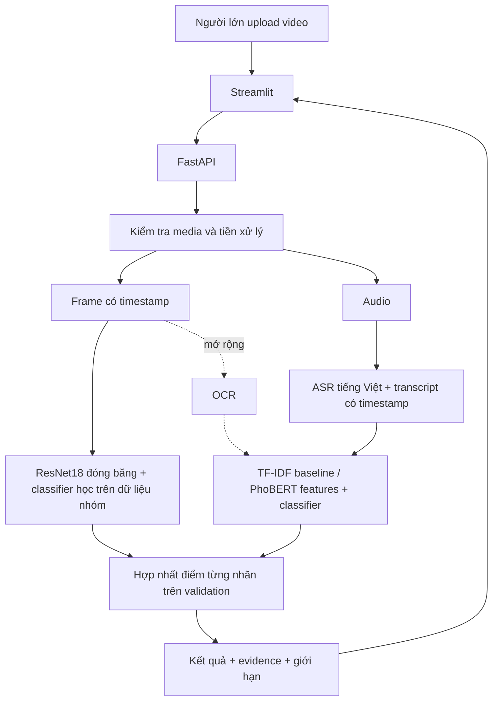

# Kiến trúc và quyết định kỹ thuật

Bản tích hợp 18/10/2026 có app, kiểm tra media, worker có timeout và pipeline model thật trên CPU. Hai nhãn P0 là Violence và Toxic tiếng Việt; chưa đánh giá trên pilot có gold.

Luồng app đã triển khai: Streamlit → FastAPI lưu file trong thư mục tạm → worker PyAV kiểm tra container và giải mã video → `analyze_video(path, backend=...)` → app validate kết quả v1 → xóa file tạm → trả JSON → UI/preview/evidence/download.

Worker là tiến trình `spawn` dùng lại, tuần tự một lượt; mỗi giai đoạn có timeout riêng. Khi timeout/crash, API dừng worker trước khi xóa file. Module model có thể cache artifact trong worker. Không thêm backend giả khác ngoài mock/model. Worker không trả metadata media vào schema v1; thống nhất riêng với Huy trước khi tối ưu việc giải mã lại trong tiền xử lý ML.

- **Streamlit + FastAPI:** cùng Python để giảm thời gian tích hợp; app owner gọi API mà không cần nạp torch. Web gọi API từ server, chưa cần bật CORS rộng.
- **Visual:** bắt đầu ResNet18 tiền huấn luyện làm bộ trích đặc trưng, rồi học classifier từ nhãn của dự án. Trọng số ImageNet không tự nhận biết “an toàn cho trẻ”. Một frame riêng lẻ cũng không đủ suy luận mọi hành động nguy hiểm.
- **Speech/text:** faster-whisper là ứng viên ASR; thử `tiny`/`base` đa ngôn ngữ trên CPU, đo chất lượng tiếng Việt và tốc độ trước khi chốt. TF-IDF + logistic regression là baseline rẻ. PhoBERT là thử nghiệm tiếp theo nếu dữ liệu/thời gian cho phép, không phải model moderation sẵn dùng.
- **Fusion:** visual có thể cung cấp điểm violence, text cung cấp toxic_language. Đây đã là kết quả đa phương thức nhưng không được gọi là “weighted fusion cùng lớp” khi hai nhánh không có nhãn chung. Nếu hai nhánh cùng dự đoán một lớp, chọn trọng số/ngưỡng trên validation; không lấy trung bình các nhãn khác nghĩa.
- **Giới hạn app:** 50 MiB, 60 giây, tối đa 8.294.400 pixel/khung và 18.000 khung. PyAV giải mã toàn bộ luồng video để phát hiện lỗi; kiểm tra âm thanh hiện chỉ xác định sự tồn tại của track. Việc trích frame 1 fps/ASR phục vụ ML vẫn do Huy thực hiện; app không tự phân loại nội dung.
- **Lưu trữ:** API dùng thư mục tạm riêng mỗi request và xóa sau xử lý. Streamlit giữ upload trong phiên; không có database. Cache thí nghiệm local, không commit. Cấu hình Compose/nginx có giới hạn body 52 MiB; chạy uvicorn trực tiếp vẫn kiểm tra 50 MiB sau multipart parsing. Triển khai công khai cần hạ tầng/TLS phù hợp và kiểm chứng riêng; mặc định chỉ demo local.
- **Phần cứng:** CPU cho app và baseline; Colab cho trích đặc trưng theo batch/fine-tune tùy chọn. Cache kết quả ASR/features một lần, không chạy lại trong mỗi notebook thử nghiệm.

Nguồn kỹ thuật đã tham khảo khi khởi tạo (05/10/2026): [Torchvision models](https://docs.pytorch.org/vision/stable/models.html), [faster-whisper](https://github.com/SYSTRAN/faster-whisper), [PhoBERT model card](https://huggingface.co/vinai/phobert-base-v2), [FastAPI UploadFile](https://fastapi.tiangolo.com/tutorial/request-files/), [Streamlit upload](https://docs.streamlit.io/develop/api-reference/widgets/st.file_uploader). Cần kiểm tra giấy phép của đúng checkpoint/dataset được chọn; chưa tải hay lựa chọn bộ dữ liệu thực ở bước khởi tạo.
