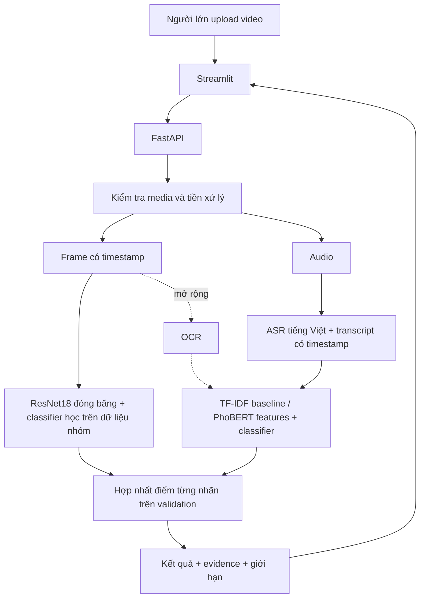

# Kiến trúc và quyết định kỹ thuật

Đây là thiết kế mục tiêu. Hiện tại chỉ có web, API, schema và mock pipeline.

- **Streamlit + FastAPI:** cùng Python để giảm thời gian tích hợp; app owner gọi API mà không cần nạp torch. Web gọi API từ server, chưa cần bật CORS rộng.
- **Visual:** bắt đầu ResNet18 tiền huấn luyện làm bộ trích đặc trưng, rồi học classifier từ nhãn của dự án. Trọng số ImageNet không tự nhận biết “an toàn cho trẻ”. Một frame riêng lẻ cũng không đủ suy luận mọi hành động nguy hiểm.
- **Speech/text:** faster-whisper là ứng viên ASR; thử `tiny`/`base` đa ngôn ngữ trên CPU, đo chất lượng tiếng Việt và tốc độ trước khi chốt. TF-IDF + logistic regression là baseline rẻ. PhoBERT là thử nghiệm tiếp theo nếu dữ liệu/thời gian cho phép, không phải model moderation sẵn dùng.
- **Fusion:** visual có thể cung cấp điểm violence, text cung cấp toxic_language. Đây đã là kết quả đa phương thức nhưng không được gọi là “weighted fusion cùng lớp” khi hai nhánh không có nhãn chung. Nếu hai nhánh cùng dự đoán một lớp, chọn trọng số/ngưỡng trên validation; không lấy trung bình các nhãn khác nghĩa.
- **Giới hạn dự kiến:** tối đa 60 giây, lấy mẫu ban đầu 1 frame/giây, tối đa 60 frame; có thể bỏ sót cảnh rất ngắn. Báo cáo phải nêu tác động của sampling. Bản mock mới kiểm tra phần mở rộng và kích thước, chưa giải mã.
- **Lưu trữ:** API dùng thư mục tạm riêng mỗi request và xóa sau xử lý; chưa có database. Cache dữ liệu thí nghiệm local, không commit. Trước khi deploy công khai cần giới hạn request ở proxy, concurrency và thời gian decode; starter chỉ chạy local.
- **Phần cứng:** CPU cho app và baseline; Colab cho trích đặc trưng theo batch/fine-tune tùy chọn. Cache kết quả ASR/features một lần, không chạy lại trong mỗi notebook thử nghiệm.

Nguồn kỹ thuật đã tham khảo khi khởi tạo (05/10/2026): [Torchvision models](https://docs.pytorch.org/vision/stable/models.html), [faster-whisper](https://github.com/SYSTRAN/faster-whisper), [PhoBERT model card](https://huggingface.co/vinai/phobert-base-v2), [FastAPI UploadFile](https://fastapi.tiangolo.com/tutorial/request-files/), [Streamlit upload](https://docs.streamlit.io/develop/api-reference/widgets/st.file_uploader). Cần kiểm tra giấy phép của đúng checkpoint/dataset được chọn; chưa tải hay lựa chọn bộ dữ liệu thực ở bước khởi tạo.
