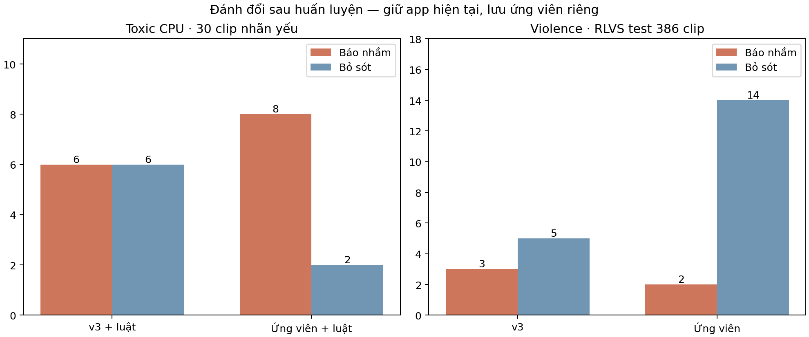

# Kết quả train speech200 và AIRTLab100 — 29/10/2026

**Đã hoàn tất hai lượt huấn luyện, đánh giá và lưu checkpoint ứng viên. Giữ app ở CPU v3 + hybrid hiện tại.** Toxic mới tăng khả năng phát hiện nhưng cũng tăng báo nhầm; Violence mới giảm kết quả test RLVS. Không tự thay model đang dùng bằng ứng viên này.

## Dữ liệu và cách học

Speech200 gồm 100 Toxic +100 bình thường **theo mô tả người cung cấp**, chưa có nhãn nghe duyệt từng clip. Đây là nhãn yếu, không phải gold. Khóa nhóm video nguồn/SHA/các cặp dHash liên thông trước ASR: **142 train /28 validation /30 test**, cân bằng hai lớp ở mỗi split. 11 clip liên quan các ca lỗi đã xem nằm ở train. Source grouping vẫn tạm, có thể còn reupload/người nói trùng; Huy đã thử các clip khác chưa liệt kê, nên không gọi đây là test mù hoàn toàn.

Whisper GPU FP16 small beam5 nhận được ASR đủ điều kiện ở **138/142 train, 28/28 validation, 29/30 test**; các phần tương ứng có 784/150/200 segment. Năm clip thiếu ASR đều thuộc nhóm người cung cấp mô tả là Toxic; không gán score0 hoặc tự sửa transcript. Fitting/loss chỉ tính clip có ASR và báo coverage; kiểm quyết định CPU tính đủ30 clip, `review` được tính là không cảnh báo.

PhoBERT khởi tạo v3, fine-tune **14.767.874 tham số** ở hai encoder block cuối và classifier trong **5 epoch**. Học nhãn cấp clip bằng max logit của các segment rồi BCE; không áp nhãn Toxic lên từng câu trong clip. Chọn **epoch5, ngưỡng0,32** chỉ từ validation GPU. Bộ luật hybrid giữ nguyên. V3 đối chiếu dùng ngưỡng đã phát hành0,78; đợt này thay cả trọng số và ngưỡng, chưa cô lập lợi ích riêng của huấn luyện.

Violence dùng **1.157 RLVS train +100 AIRTLab (50/50)**. Cả bối cảnh AIRTLab chuyển sang train theo yêu cầu, không còn là external test của ứng viên này. R3D-18 vẫn đóng băng; fit StandardScaler + Logistic Regression balanced, thử4 giá trị C, chọn **C0,01/ngưỡng0,64** trên RLVS validation386. Không ứng viên nào đạt đồng thời điều kiện FP/Recall của baseline trên validation; ứng viên tốt nhất còn lại được lưu để báo cáo, không đủ điều kiện thay app. Test RLVS386 giữ nguyên và chỉ tính sau selection.

## Toxic: kết quả CPU gần với cách app xử lý lời nói

Đã chạy lại ASR **CPU INT8** và hai classifier **CPU** trên cùng30 clip giữ riêng, sau khi model/ngưỡng đóng băng. Đây chỉ là nhánh Toxic, không phải Accuracy toàn app đa phương thức. Nhãn tham chiếu vẫn là nhãn yếu.

| Cách chạy, đủ30 clip | Accuracy | Precision | Recall | F1 | Báo nhầm FP | Bỏ sót FN |
|---|---:|---:|---:|---:|---:|---:|
| v3 model-only | 53,33% | 54,55% | 40,00% | 46,15% | 5 | 9 |
| Ứng viên model-only | 63,33% | 61,11% | 73,33% | 66,67% | 7 | 4 |
| v3 + luật hiện tại | 60,00% | 60,00% | 60,00% | 60,00% | 6 | 6 |
| Ứng viên + luật | 66,67% | 61,90% | 86,67% | 72,22% | 8 | 2 |

Trong15 clip được mô tả là bình thường, ứng viên hybrid cảnh báo8 clip. Kết quả chưa đáp ứng mục tiêu giảm báo nhầm. Cần nghe duyệt lại nhãn/transcript và bổ sung dữ liệu dev phù hợp trước khi cân nhắc thay app. Có danh sách10 bất đồng FP/FN để rà soát local ở `runs/local-adaptation-2026-10-29/cpu_error_review.csv`; đây là rà soát sau dự đoán, không phải gán nhãn mù.

**Loss model-only trên29 clip có ASR CPU:** v3 **1,7724** → ứng viên **0,7604**; Accuracy55,17%→65,52%, F148,00%→68,75%. Không tính Loss cho hybrid vì luật chỉ tạo quyết định, không có xác suất gộp. Không trộn support29 của loss với support30 của bảng quyết định.

GPU ASR cho transcript khác CPU: trên29 clip test có ASR, model-only Accuracy68,97%→72,41%, F166,67%→73,33%, Loss1,4000→0,6298; trên validation28 F145,45%→69,23%. Vì khác transcript, không dùng kết quả GPU thay cho CPU. Không chỉnh lại ngưỡng bằng test CPU vừa thấy.

## Violence: kết quả test giảm

| RLVS test386 | Accuracy | Precision | Recall | F1 | FP | FN | Loss |
|---|---:|---:|---:|---:|---:|---:|---:|
| v3 | 97,93% | 98,47% | 97,47% | 97,97% | 3 | 5 | 0,0760 |
| Ứng viên thêm AIRTLab | 95,85% | 98,92% | 92,93% | 95,83% | 2 | 14 | 0,0935 |

Ứng viên giảm1 báo nhầm nhưng tăng9 bỏ sót. Trên AIRTLab, Accuracy53%→91%, FP39→1, FN8→8; **đây là kết quả trên100 clip đã đưa vào train**, không chứng minh khả năng khái quát. Báo cáo AIRTLab external cũ vẫn là lịch sử cho v3, không áp sang model mới.

## CSV, đồ thị và checkpoint

- [CSV tổng hợp](local-adaptation-2026-10-29/summary.csv), [protocol đã khóa](local-adaptation-2026-10-29/protocol.json), [chia dữ liệu](local-adaptation-2026-10-29/data_summary.json), [quyết định giữ app](local-adaptation-2026-10-29/deployment_decision.json).
- Toxic: [history5epochCSV](local-adaptation-2026-10-29/toxic/training_history.csv), [đồ thị Accuracy/Loss/F1](local-adaptation-2026-10-29/toxic/training_history.png), [train/validation/testGPU](local-adaptation-2026-10-29/toxic/metrics_by_split.csv), [đồ thị](local-adaptation-2026-10-29/toxic/metrics_by_split.png), [CPU đủ30clip](local-adaptation-2026-10-29/toxic/cpu_holdout_decisions.csv), [CPU29clip có ASR/Loss](local-adaptation-2026-10-29/toxic/cpu_holdout_probabilities.csv).
- Violence: [train/validation/testCSV](local-adaptation-2026-10-29/violence/metrics_by_split.csv), [đồ thị](local-adaptation-2026-10-29/violence/metrics_by_split.png), [lịch sử4lượt fit](local-adaptation-2026-10-29/violence/fit_history.csv), [AIRTLab training-only](local-adaptation-2026-10-29/violence/airtlab_training_only.csv). Logistic regression không có history epoch được ghi, không dựng đường loss theo epoch giả. Hai nhánh đều có confusion matrix, PR/ROC PNG/SVG trong thư mục tương ứng.
- Checkpoint Toxic local: `runs/local-adaptation-2026-10-29/toxic/selected/`; checkpoint resume/best cũng được giữ. Violence local: `runs/local-adaptation-2026-10-29/violence/selected.joblib`, kèm `r3d18-kinetics400.pth` đã xác minh để nạp CPU. Raw/ASR/nguồn/weights không đưa vào Git.

Loss epoch là BCE cấp clip đo khi model.eval, khác optimizer loss đo trong lúc học có dropout. Ở ngưỡng cố định0,5, validation loss giảm1,4126→0,6869 qua5epoch; F1 cuối ở0,5 là64%, khác69,23% ởngưỡng0,32 được chọn. Không dùng train score để kết luận chất lượng.

## Kiểm chứng và tiếp tục

**244 tests pass**, môi trường train `pip check` pass,17 artifact đang phục vụ vẫn đúng checksum. Xác minh8 tệp Toxic/2 tệp Violence ứng viên. So inference CPU với feature GPU trên10 mẫu AIRTLab **train** gần ngưỡng:10/10 quyết định khớp, lệch score lớn nhất4,17e-7; đây là kiểm kỹ thuật, không phải testaccuracy. [Biên bản artifact/CPU](local-adaptation-2026-10-29/artifact_cpu_verification.json).

App chưa đổi phiên bản: cả hai ứng viên đã được huấn luyện/lưu, nhưng chưa đủ bằng chứng để nâng bản. Cần rà soát nhãn/bằng chứng của dữ liệu lời nói, tìm thêm nguồn Violence khác bối cảnh để đánh giá ngoài, thiết kế run tiếp theo trên train/dev. Holdout lần này đã được đánh giá; không dùng nó để dò lại ngưỡng rồi gọi là test độc lập mới. [Cách tái tạo và resume](../docs/LOCAL_ADAPTATION_2026-10-29.md).
