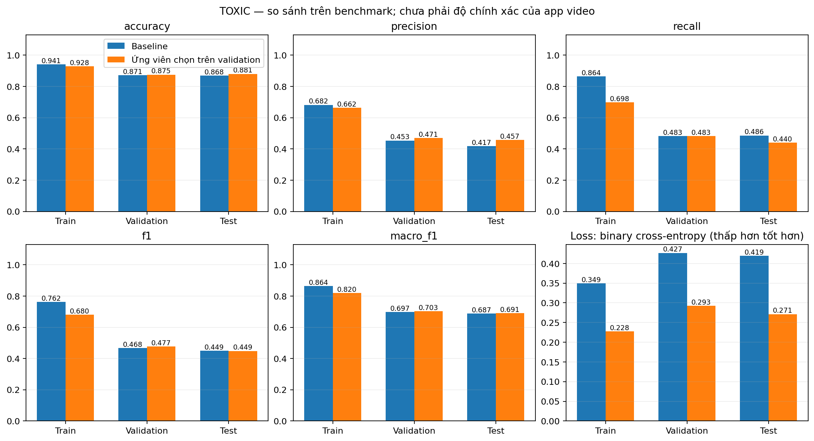
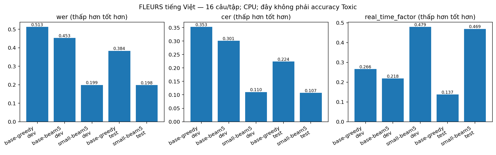
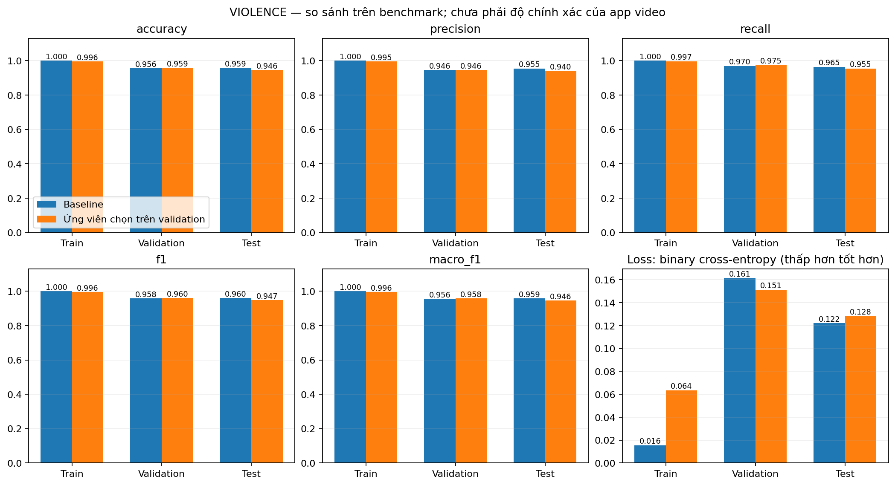

# Cải thiện model và đánh giá — 20/10/2026

Đã hoàn tất huấn luyện/chọn cấu hình, đánh giá Toxic/Violence/ASR và kích hoạt bundle `kidsafe-cpu-v2` sau kiểm thử. Run: `model-improvement-2026-10-20`. Chỉ xem xét Toxic/Violence; Sexual/Dangerous tiếp tục chưa đánh giá.

**Kết luận:** nâng ASR lên Whisper small beam5; giữ hai classifier v1 vì ứng viên mới không cải thiện đủ trên test. Chưa giải quyết được bỏ sót Violence trên video thực tế, cũng chưa chứng minh hết cảnh báo Toxic nhầm. [CSV tổng hợp train/validation/test](model-improvement-2026-10-20/metrics_by_split.csv) · [CSV so sánh test](model-improvement-2026-10-20/comparison.csv) · [CSV confusion matrix](model-improvement-2026-10-20/confusion_matrix.csv).

## Toxic: giảm cảnh báo nhầm nhưng chưa cải thiện recall

Giữ nguyên ViCTSD sau làm sạch: train 6.965, validation 1.975, test 988 (109 Toxic). Đã fit 6 cấu hình char/word+char TF-IDF + Logistic Regression, thử regularization và class weights. Chọn ngưỡng bằng validation; chỉ đánh giá test của cấu hình được chọn và baseline.

Ứng viên được chọn là char TF-IDF + LR C=1, không class weight, ngưỡng 0,20. Tiêu chí chọn: macro-F1 cao nhất trong các cấu hình/ngưỡng có precision và recall Toxic validation không thấp hơn baseline. Không dùng test để chọn hoặc chỉnh lại ngưỡng.

| Chỉ số trên test ViCTSD | Baseline v1 | Ứng viên chọn trên validation |
|---|---:|---:|
| Accuracy | 86,84% | 88,06% |
| Log loss | 0,4193 | 0,2714 |
| Precision Toxic | 41,73% | 45,71% |
| Recall Toxic | 48,62% | 44,04% |
| F1 Toxic | 44,92% | 44,86% |
| Macro-F1 | 68,72% | 69,08% |
| Cảnh báo nhầm FP | 74 | 57 |
| Bỏ sót FN | 56 | 61 |

**Giữ classifier Toxic v1 trong app.** Ứng viên giảm 17 FP nhưng bỏ sót thêm 5 ca Toxic; chưa đạt cải thiện cân bằng precision/recall. Loss thấp hơn không đồng nghĩa bắt được nhiều nội dung độc hại hơn. Accuracy của cả hai vẫn thấp hơn baseline luôn đoán Non-toxic (88,97%); không dùng accuracy riêng để khẳng định model tốt.

[CSV đầy đủ các split](model-improvement-2026-10-20/toxic/metrics_by_split.csv) · [Confusion matrix](model-improvement-2026-10-20/toxic/confusion_matrix.png) · [PR/ROC](model-improvement-2026-10-20/toxic/test_curves.png) · [Learning curve](model-improvement-2026-10-20/toxic/learning_curve.png).

## ASR: cải thiện nhận dạng lời nói trước classifier

So Whisper base beam1 (ID `base-greedy`, còn temperature fallback mặc định), base beam5 và small beam5 trên 16 câu dev FLEURS tiếng Việt; chọn small beam5 theo WER dev trong các cấu hình có hệ số thời gian ≤2,5. Sau khi khóa lựa chọn, so baseline và small trên 16 câu test riêng, không trùng prompt ID với dev. Whisper được dùng dưới dạng pretrained, không fine-tune trên FLEURS.

| Chỉ số test ASR | Base greedy | Small beam5 |
|---|---:|---:|
| WER (token cách bằng khoảng trắng) | 38,36% | 19,83% |
| CER (bỏ khoảng trắng, giữ dấu tiếng Việt) | 22,40% | 10,70% |
| Số lỗi từ / số token tham chiếu | 178 / 464 | 92 / 464 |
| Tổng thời gian nhận dạng 193,44 giây audio | 26,60 giây | 90,71 giây |
| Hệ số thời gian xử lý / thời lượng audio | 0,137 | 0,469 |

WER giảm khoảng 48,3% tương đối, nhưng vẫn còn gần 20% lỗi token trong mẫu nhỏ này. Small chậm khoảng 3,4 lần trong lượt đo; CPU đồng thời chạy trích feature Violence, nên không coi đây là benchmark tốc độ cô lập. Số liệu không đại diện đầy đủ cho tiếng nói đời thường, nhạc nền, phương ngữ hoặc TikTok.

Giữ nguyên classifier Toxic v1 và cách max theo đoạn: trên 16 câu test, số cảnh báo do transcript ASR mà classifier không đưa ra khi đọc transcript tham chiếu giảm 2 → 0. Đây là **bất đồng giữa hai đầu vào của cùng classifier**, không phải FP có nhãn Toxic do người gán. Không đổi cách gộp đoạn dựa vào phép đo này.

[CSV ASR](model-improvement-2026-10-20/asr/asr_metrics.csv) · [Audit ảnh hưởng lên Toxic](model-improvement-2026-10-20/asr/toxic_asr_output_changes.csv).

## Violence: lấy mẫu dày hơn chưa cải thiện test

Giữ nguyên 1.929 video RLVS và nhóm/split của baseline: train 1.157, validation 386, test 386 (198 Violence). Thử 9 cấu hình: 8 frame mean/max, 24 frame mean/max, 24 frame mean/max thêm độ lệch chuẩn và biến thiên embedding liền kề; mỗi loại thử C=0,01/0,1/1. ResNet18 đóng băng; chỉ học scaler và Logistic Regression trên train.

Tiêu chí validation định trước là recall cao nhất, với FP không vượt baseline và macro-F1 không thấp hơn baseline quá 0,005. Chọn 24 frame mean/max, C=0,01, balanced weights, ngưỡng 0,45: validation FN giảm 6 → 5, FP giữ 11. Biến thiên embedding không được chọn và không phải một model học chuyển động theo thời gian.

| Chỉ số test RLVS | Baseline 8 frame | Ứng viên 24 frame |
|---|---:|---:|
| Accuracy | 95,85% | 94,56% |
| Log loss | 0,1221 | 0,1283 |
| Precision Violence | 95,50% | 94,03% |
| Recall Violence | 96,46% | 95,45% |
| F1 Violence | 95,98% | 94,74% |
| Macro-F1 | 95,85% | 94,55% |
| FP / FN | 9 / 7 | 12 / 9 |

**Giữ Violence v1 (8 frame, ngưỡng 0,43) trong app.** Cải thiện nhỏ trên validation không lặp lại trên test. Không chọn lại một trong các ứng viên khác hoặc chỉnh ngưỡng sau khi xem kết quả test này. Benchmark vẫn có nguy cơ gần trùng nguồn chưa nhận diện được; SHA/dHash không thay thế ID nguồn gốc.

Một số video phát cảnh báo decoder H.264 khi trích feature; không có mẫu nào bị loại thêm trong lượt này, không đổi split. Chưa có mốc bạo lực do người xem gán để kết luận lấy frame bỏ lỡ đúng đoạn nào. Xuất 70 hàng lỗi validation/test của hai phiên bản vào bảng review private, chưa điền nhận xét bằng người.

[CSV Violence](model-improvement-2026-10-20/violence/metrics_by_split.csv) · [Confusion matrix](model-improvement-2026-10-20/violence/confusion_matrix.png) · [PR/ROC](model-improvement-2026-10-20/violence/test_curves.png) · [Learning curve](model-improvement-2026-10-20/violence/learning_curve.png).

## Đọc đồ thị Loss và giới hạn

Train F1 Toxic baseline 76,23% so với test 44,92% cho thấy khoảng cách đáng kể; mô hình chưa đủ tốt chỉ nhờ tối ưu classifier tuyến tính. Violence baseline train accuracy 100% nhưng test 95,85%; độ đúng cao trên RLVS không chứng minh chất lượng trên video dọc có nhạc/biên tập. Các CSV ghi đủ support và metric hai lớp để đối chiếu.

Loss được tính thật từ xác suất dự đoán: binary cross-entropy không trọng số. Các classifier dùng Logistic Regression; không có lịch sử train theo epoch của solver cũ. Đường học được tạo bằng fit các tập train con với 20/40/60/80/100% dữ liệu, đo train/validation; trục là số mẫu, không phải epoch. Không dùng test trong đường học.

ViCTSD/RLVS là test benchmark đã từng báo cáo, được giữ khỏi vòng lựa chọn cấu hình mới; không gọi chúng là một phép đánh giá video đích hoàn toàn chưa xem. Tập pilot vẫn chờ nhãn người thật. Huy xác nhận chưa lưu các video báo lỗi, nên chưa thể khẳng định đã sửa đúng những ca đó.

Tái lập và định nghĩa file: [MODEL_EXPERIMENTS.md](../docs/MODEL_EXPERIMENTS.md). CSV từng mẫu và danh sách lỗi có text/đường dẫn video nằm trong `runs/model-improvement-2026-10-20/`, không đưa lên Git. Các PNG có bản SVG cùng tên để đưa vào slide/báo cáo.

## Bản đưa vào app và kiểm thử

- **CPU v2:** Toxic v1 ngưỡng 0,59; Violence v1 lấy 8 frame, ngưỡng 0,43; Whisper small beam5/temperature=0. Không đổi schema, cách max Toxic theo đoạn hoặc hai nhãn chưa hỗ trợ.
- **146 tests regression pass**, không lỗi/bỏ qua; `pip check` pass. Thêm kiểm tra feature train–inference, metric không xác định và khôi phục cấu hình v1.
- **13/13 ca HTTP/model thật pass** trên máy Huy. Video không tiếng/âm thử giữ Toxic null, đủ hai score ở mẫu tiếng Việt, file lỗi trả đúng mã.
- **8 ca UI AppTest pass, 1 ca chưa chạy**: mẫu FLEURS không còn evidence nên chưa thực hiện seek evidence bằng mẫu này. Không gọi là 9/9 hoặc kiểm thử trình duyệt thủ công. Widget evidence đã có unit test.
- Cài ZIP thật vào thư mục kiểm tra riêng và xác minh **9/9 tệp**. Sau đó kích hoạt vào thư mục model chính; giữ ZIP v1 và manifest để khôi phục. [Bằng chứng tích hợp](model-improvement-2026-10-20/integration_checks.json).

Mẫu giọng nói smoke cũ hiện trả `review`, Toxic score 0,3985 dưới ngưỡng 0,59; hai lần gọi sau khi đã nạp model mất khoảng 8,8 giây. Đây là một fixture kỹ thuật, không phải nhãn gold hoặc benchmark latency đại diện. Không dùng kết quả này để thay thế các clip lỗi chưa lưu của Huy.

Bundle ZIP nằm tại `models/checkpoints/bundle/kidsafe-cpu-v2.zip`, không trên Git. [Cách mở app/cài máy thành viên app/rollback](../docs/MODEL_UPDATE_2026-10-20.md). PDF/PPTX cũ chưa được cập nhật theo đợt thực nghiệm này; dùng CSV/PNG/SVG và báo cáo này khi bổ sung bài nộp.

Việc còn lại cần người: gán 25 clip pilot, gán chéo 6 clip, phân xử và đo toàn pipeline; lưu ca lỗi thực tế cùng nhãn/mốc thời gian; kiểm lại v2 trên máy Tiến và quay demo. Đây là các mục chưa hoàn tất, không gộp vào tỷ lệ hoàn thành thí nghiệm benchmark.
