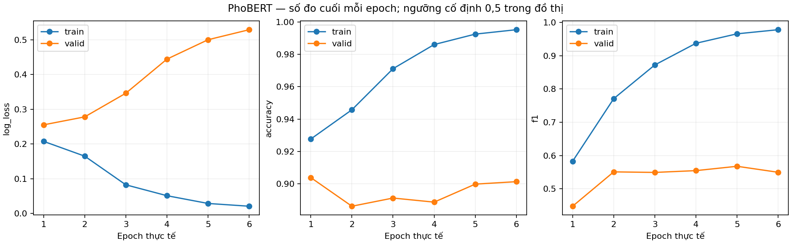
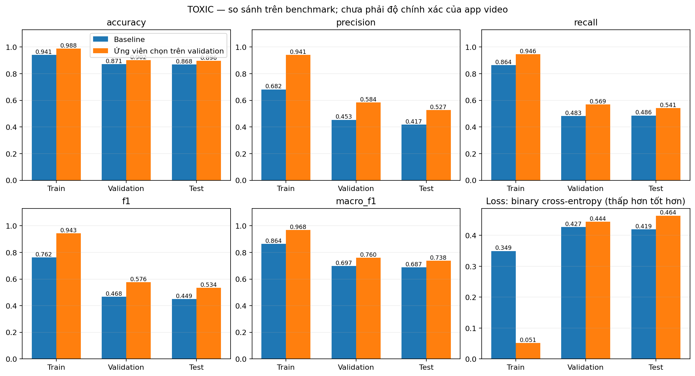
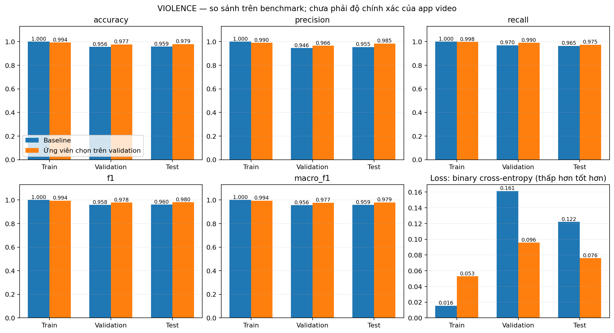
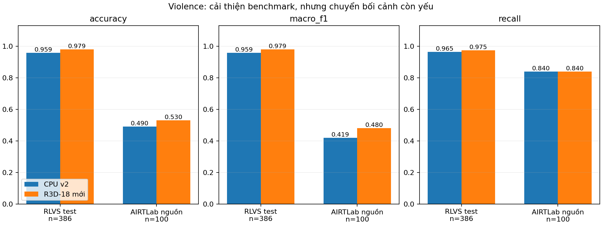

# Cải tiến Toxic và Violence — 28/10/2026

Đã fine-tune PhoBERT và huấn luyện classifier Violence trên đặc trưng R3D-18. Cả hai cải thiện chỉ số phân loại so với bundle CPU v2 trên các benchmark đã dùng, nhưng **chưa giải quyết tốt khác biệt bối cảnh thực tế**. Đặc biệt AIRTLab chỉ đạt 53% Accuracy và PhoBERT còn quá khớp. Không công bố đây là độ chính xác của toàn app hay khả năng bảo vệ trẻ em ngoài thực tế.

## Kết quả test đã khóa

| Tập / model | Accuracy | Precision lớp rủi ro | Recall lớp rủi ro | F1 lớp rủi ro | Macro-F1 | Loss | FP | FN |
|---|---:|---:|---:|---:|---:|---:|---:|---:|
| ViCTSD / TF-IDF cũ | 86,84% | 41,73% | 48,62% | 44,92% | 68,72% | 0,4193 | 74 | 56 |
| ViCTSD / PhoBERT | **89,57%** | **52,68%** | **54,13%** | **53,39%** | **73,76%** | 0,4641 | **53** | **50** |
| RLVS / ResNet18 cũ | 95,85% | 95,50% | 96,46% | 95,98% | 95,85% | 0,1221 | 9 | 7 |
| RLVS / R3D-18 | **97,93%** | **98,47%** | **97,47%** | **97,97%** | **97,93%** | **0,0760** | **3** | **5** |
| AIRTLab / ResNet18 cũ | 49,00% | 49,41% | 84,00% | 62,22% | 41,88% | 1,5300 | 43 | 8 |
| AIRTLab / R3D-18 | **53,00%** | **51,85%** | 84,00% | **64,12%** | **48,00%** | **0,9892** | **39** | 8 |

Support: ViCTSD test 988 bình luận = 879 bình thường + 109 Toxic; RLVS test 386 = 188 bình thường + 198 Violence; AIRTLab 100 = 50/50. Loss là binary cross-entropy không trọng số trên điểm model. Ngưỡng PhoBERT 0,78; R3D-18 0,41; baseline 0,59/0,43. F1 trong cột chính là lớp rủi ro, khác macro-F1 trung bình hai lớp. Accuracy không đủ để đánh giá dữ liệu lệch lớp: đoán toàn bình thường trên ViCTSD test đã đạt 88,97% nhưng recall Toxic bằng 0.

PhoBERT tăng F1 8,48 điểm phần trăm và giảm báo nhầm khoảng 28,4%, nhưng vẫn bỏ sót 50/109 ca Toxic. Loss tăng 0,4193 → 0,4641: chất lượng phân loại tại ngưỡng tốt hơn không đồng nghĩa điểm đã được calibration. Trên AIRTLab, R3D-18 vẫn báo nhầm **39/50 video bình thường**. Những số liệu này cần được giữ trong bài nộp, không chỉ trình bày RLVS gần 98%.

## Quy trình và tính độc lập của dữ liệu

Giữ split ViCTSD 6.965/1.975/988 và RLVS 1.157/386/386; scaler, classifier và trọng số lớp chỉ học từ train. Chọn checkpoint/ngưỡng trên validation. ViCTSD/RLVS test đã được công bố trong các lượt trước, nên lượt này là so sánh trên benchmark cũ, **không phải một test đích mới chưa từng xem**. Không đổi ngưỡng hoặc chọn lại ứng viên theo kết quả test.

PhoBERT-base được fine-tune toàn bộ 6 epoch, seed 42, PyVi, tối đa 192 token; batch 8 × tích lũy 2; lr 2e-5, AdamW decay 0,01, warmup 10%, AMP. Chọn **epoch 4** với ngưỡng 0,78 theo macro-F1 validation dưới ràng buộc precision/recall không thấp hơn baseline. 52/17/3 bình luận train/validation/test bị cắt tới giới hạn token. Đồ thị cho thấy train tiếp tục tốt lên trong khi validation loss tăng: đã có quá khớp, không lấy checkpoint cuối chỉ vì train accuracy cao. PyVi khác RDR dùng trong tiền huấn luyện PhoBERT.

Violence thử 6 cấu hình từ R3D-18 Kinetics400 đóng băng, hoặc ghép ResNet18 static, với C=0,01/0,1/1. Chọn **R3D-18 riêng, StandardScaler + LR balanced C=0,01**; 5 cửa sổ × 16 frame ở 15 fps, mean/max embedding 1.024 chiều. Nhóm huấn luyện lớp LR; không tuyên bố đã fine-tune R3D. Khác baseline, backbone 3D xử lý chuỗi chuyển động, nhưng 5 cửa sổ vẫn có thể bỏ sót hành động nằm giữa các cửa sổ. Evidence vẫn ở cấp toàn clip.

AIRTLab từ Drive được đối chiếu đủ 100 Git blob với kho tác giả, không thấy trùng SHA/dHash với RLVS qua kiểm tra hiện có. Đây là hành động dàn dựng trong một bối cảnh/camera; cả 100 clip được giữ ngoài train/validation. Nhãn là **nhãn gốc tác giả**, chưa phải nhãn người của nhóm xác nhận theo tiêu chí KidSafeReels. Không tự chia ngẫu nhiên các clip cùng bối cảnh vào train/test hoặc dùng kết quả này để dò ngưỡng.

Chi tiết tái tạo, revision, môi trường và giới hạn: [quy trình thực nghiệm](../docs/MODEL_IMPROVEMENT_2026-10-28.md), [protocol Toxic](model-improvement-2026-10-28/toxic/protocol.json), [protocol Violence](model-improvement-2026-10-28/violence/protocol.json), [audit AIRTLab](model-improvement-2026-10-28/airtlab_data_audit.json).

## CSV, đồ thị và review lỗi

- [Tất cả metric train/validation/test](model-improvement-2026-10-28/metrics_by_split.csv), [so sánh test](model-improvement-2026-10-28/comparison.csv), [confusion matrix](model-improvement-2026-10-28/confusion_matrix.csv), [AIRTLab](model-improvement-2026-10-28/airtlab_comparison.csv).
- [Lịch sử train PhoBERT thật](model-improvement-2026-10-28/toxic/training_history.csv): loss/accuracy/F1 mỗi epoch, không dựng lại từ một điểm cuối. Đồ thị epoch dùng ngưỡng cố định 0,5; metric checkpoint cuối dùng ngưỡng chọn trên validation.
- Mỗi thư mục `toxic/`, `violence/` có `metrics_by_split.png/.svg`, `confusion_matrix.png/.svg`, `test_curves.png/.svg`. Violence có thêm `learning_curve.csv/.png/.svg` theo số mẫu train con, **không phải epoch**.
- Review lỗi private: `runs/model-improvement-2026-10-28/toxic/error_review.csv` (682 hàng) và `violence/error_review.csv` (50 hàng), gồm cả hai phiên bản và validation/test. Chưa tự điền nhận xét người. Không commit nội dung bình luận/video/prediction từng clip.

## Phát hành và phần còn lại

Cả hai vượt điều kiện nâng bản thử nghiệm tương đối với v2 đã ghi trước test trong [release gate](model-improvement-2026-10-28/release_gate.json). Whisper small beam5 giữ nguyên; không có thí nghiệm ASR mới, Sexual/Dangerous vẫn null. Trạng thái tích hợp thực tế được lưu tại [release decision](model-improvement-2026-10-28/release_decision.json); không coi checkpoint hoàn tất là app đã nghiệm thu.

Tiếp theo cần nhãn pilot, các clip báo nhầm/bỏ sót thực tế và tập mới có nhiều bối cảnh nguồn độc lập. Không dùng lại 100 AIRTLab này như test chưa từng thấy nếu sau này dùng chúng để phát triển model. PDF/PPTX cũ chưa tự cập nhật theo báo cáo này; cần đưa cả kết quả yếu và giới hạn vào bản nộp. Quyền tải dataset không tự đồng nghĩa quyền tái phân phối raw video; checkpoint và dữ liệu được giữ local.

**CPU v3 đã kích hoạt sau kiểm thử:** 152 tests pass, pip check, 13/13 ca HTTP/model thật, 8 UI AppTest pass + 1 chưa chạy vì fixture không có evidence. Cài ZIP thật vào thư mục riêng và kiểm 17 tệp pass. [Biên bản kiểm thử](model-improvement-2026-10-28/integration_checks.json), [cách mở/cài/rollback](../docs/MODEL_UPDATE_2026-10-28.md). Chưa kiểm trên máy Tiến hoặc thao tác trình duyệt thủ công ở lượt này.

Latency CPU ở mẫu nhỏ: 32 bình luận/10 clip train, Toxic median lượt sau ~0,059 giây/bình luận, Violence ~2,56 giây/clip (bao gồm tiền xử lý từng nhánh, chưa gồm ASR/API). HTTP fixture cold 21,01 giây; speech hai lượt 9,51/9,18 giây. Không coi đây là benchmark latency đại diện Shorts. [Số đo CPU](model-improvement-2026-10-28/cpu_benchmark.json), [HTTP](model-improvement-2026-10-28/http_acceptance.json).

Kiểm tra số học CPU/GPU ban đầu không đạt sai số tuyệt đối 1e-4 cho Violence. Đã giữ nguyên bản ghi failed và chẩn đoán: cùng pixel, cuDNN TF32 làm tròn khác FP32. GPU FP32 trên toàn 386 test (+9 validation gần ngưỡng) không đổi quyết định; CPU trên 20 mẫu validation/test gần ngưỡng khớp FP32 với sai số tối đa **8,23e-7**, không đổi nhãn. [Biên bản xử lý](model-improvement-2026-10-28/cpu_parity_resolution.json). Không đổi model/ngưỡng hoặc che lần kiểm đầu thất bại; đây là xác nhận triển khai, không thêm một lần chọn model bằng test.

Nguồn mô hình/dữ liệu: [PhoBERT](https://huggingface.co/vinai/phobert-base), [PyVi](https://github.com/trungtv/pyvi), [R3D-18](https://docs.pytorch.org/vision/stable/models/generated/torchvision.models.video.r3d_18.html), [AIRTLab](https://github.com/airtlab/A-Dataset-for-Automatic-Violence-Detection-in-Videos).
