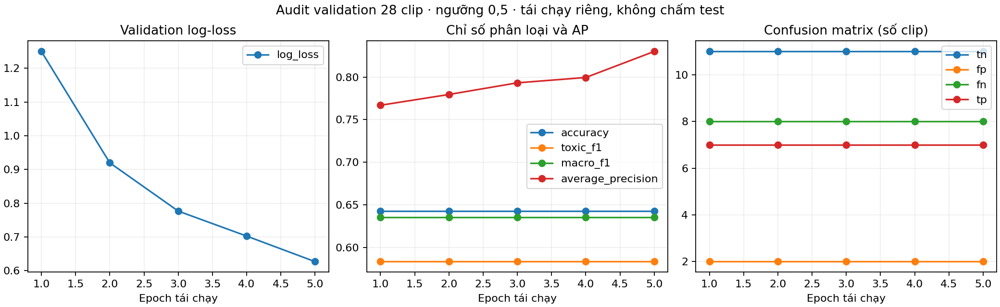

# Audit PhoBERT Toxic speech — 15/11/2026

**Đã tái hiện hiện tượng, chưa tìm thấy lỗi cache/metrics gây đóng băng kết quả.** Ở ngưỡng 0,5, điểm thay đổi nhưng quyết định của cả 28 clip validation không đổi trong lần tái chạy. Loss giảm chủ yếu vì các lỗi dự đoán sai trở nên bớt tự tin; chúng vẫn chưa vượt ngưỡng để thành dự đoán đúng. AP tăng. Đây không phải bằng chứng model đã tốt trên video mới.

**Phát hiện quan trọng về dữ liệu:** video nguồn/nhóm gần trùng đã tách, nhưng chưa thể xác nhận speaker-disjoint. Có kênh và nhóm tên người nói giao nhau giữa các split. ASR còn mất lời, có mốc thừa và một trường hợp OOV ảnh hưởng từ thuộc bộ luật; các vấn đề này cần phân biệt với lỗi tính metrics.

Audit giữ nguyên pipeline, split, nhãn, ASR, checkpoint gốc và model active. Chỉ thêm script, artifact chẩn đoán và bản tái chạy riêng. Không inference hoặc tuning trên test. Test chỉ được đọc nhãn/hash/ASR để thống kê tính toàn vẹn và trùng transcript.

## 1. Split, số mẫu, trùng và nhãn

Code tạo split: [`speech_groups` và `split_speech`](../ml/local_adaptation.py). Nhóm liên thông từ ID video nguồn, SHA media và các cặp gần trùng được phát hiện; 11 clip đã xem được ép về train cùng nhóm. GroupShuffleSplit dùng seed cố định và cân bằng nhãn nguồn. [`toxic_precision.py`](../ml/toxic_precision.py) giữ split; [`toxic_reviewed.py`](../ml/toxic_reviewed.py) nhập nhãn người vào cùng split.

Đã **chạy lại code tạo split**, không ghi vào manifest gốc: **0 khác biệt** về split/training_group. Kiểm SHA thực tế đủ 200 video: 0 sai khác; SHA giữa ASR và media: 0 sai khác.

| Split | Clip/video_id | Video nguồn | Nhóm liên thông | Nhãn 0 / 1 | Clip có ASR | Đoạn ASR |
|---|---:|---:|---:|---:|---:|---:|
| Train | 142 | 92 | 86 | 71 / 71 | 138 | 764 |
| Validation | 28 | 20 | 20 | 13 / 15 | 28 | 162 |
| Test — chỉ integrity | 30 | 20 | 20 | 14 / 16 | 29 | 232 |
| Tổng | 200 | 132 | 126 | 98 / 102 | 195 | 1.158 |

Đơn vị loss/metrics lời nói là **video**, không phải 1.158 đoạn độc lập. Train thực sự có 138 video / 71 âm + 67 dương sau loại 4 clip thiếu ASR khỏi tối ưu xác suất. Validation đủ 28 video, thứ tự ID giữ nguyên. Các mốc timestamp/segment ID không trở thành nhãn gold từng đoạn.

Nguồn rehearsal ViCTSD có **6.965 mẫu train (6.206 âm / 759 dương)** và **1.975 mẫu validation (1.743 âm / 232 dương)**. Chỉ train được lấy vào batch rehearsal; validation bình luận là điều kiện chọn checkpoint. Không mở ViCTSD test trong audit này.

| Trường kiểm tra | Giá trị xuất hiện ở nhiều split | Kết luận |
|---|---:|---|
| video_id, original_video_id | 0 | Không trùng ID giữa split |
| SHA media | 0 | Không trùng byte media giữa split |
| source_group_id | 0 | Không giao ID video nguồn đã biết |
| training_group | 0 | Không giao nhóm liên thông đã tạo |
| speaker_id | Chưa có: thiếu 200/200 | Không đủ dữ liệu xác minh speaker leakage |
| source_channel_id | 12 | 6 giao train–valid, 8 train–test, 2 valid–test |
| query_speaker_group | 18 | 11 giao train–valid, 11 train–test, 4 valid–test |

Hai trường cuối là proxy: kênh đăng và từ khóa/nhóm tìm kiếm, có nhóm nhiều người. Không đồng nhất chúng với danh tính người nói đã xác minh. **Không được kết luận bộ này speaker-independent.** Hash/nhóm nguồn không loại trừ mọi reupload hoặc cùng người nói ở các video khác.

Trùng ASR sau NFC/casefold/gộp khoảng trắng, bỏ rỗng:

- **Toàn clip:** 195 bản không rỗng, 194 chuỗi duy nhất; 1 nhóm trùng / 1 bản dư, cùng train, cùng nhãn. Không có trùng nguyên transcript clip qua split.
- **Từng đoạn:** 1.158 bản, 1.111 chuỗi duy nhất; 29 nhóm trùng / 47 bản dư; 2 nhóm xuất hiện qua split. 3 nhóm có nhãn **video** khác nhau, trong đó 1 nhóm giao split.
- Bất đồng nhãn video trên cùng câu không tự chứng minh nhãn đoạn sai: clip Toxic có thể chứa câu bình thường. Transcript boilerplate/ASR lặp cũng có thể trùng mà không phải video trùng. Không tự xóa/sửa những mẫu này.

`training_label` khớp `annotation.toxic_language` ở **200/200**, đều integer 0/1; 8 nhãn khác nhãn nguồn cũ đã được lưu rõ. Trường legacy `human_label` vẫn null và `label_origin` còn mô tả nhãn nguồn, nhưng trainer **không dùng hai trường đó**. Chúng có thể gây hiểu nhầm khi đọc manifest, chưa gây lỗi mapping trong run được audit.

## 2. Mapping, logits, loss, threshold và aggregation

| Hạng mục | Bằng chứng/kết quả |
|---|---|
| Mapping | Dataset/annotation: 0 bình thường, 1 Toxic; trainer dùng training_label và cột score 1 |
| num_labels | Nạp model thực tế được 2; id2label generic LABEL_0/LABEL_1, ý nghĩa được xác nhận từ code/data |
| Logits | Mỗi clip có tensor `[số đoạn, 2]`; không nhầm batch dimension với class dimension |
| Probability | `sigmoid(z1-z0)` khi train/evaluate; tương đương `softmax(logits, dim=-1)[:,1]` ở runtime, lệch float tối đa khoảng 5,96e-8 |
| Gộp video | Max log-odds / max probability các đoạn; nhãn target ở cấp video |
| Loss speech | BCEWithLogitsLoss trên max(z1-z0), không BCE trực tiếp trên hai logits và không sigmoid hai lần |
| Loss rehearsal | CE với nhãn integer trên batch 8 bình luận ViCTSD train, cân bằng 4/4; trọng số 0,5 |
| Chế độ học | model.train() đầu mỗi epoch; chỉ cập nhật hai encoder block cuối + classifier |
| Validation | model.eval() + torch.inference_mode(); forward không gradient, chạy lặp cùng input không đổi logits |
| Metrics | Tính trên toàn 28 video theo đúng ID; không lấy trung bình F1 từng batch |

Code liên quan: [`speech_mil.py`](../ml/speech_mil.py), [`toxic_reviewed_train.py`](../ml/toxic_reviewed_train.py), [`experiment_metrics.py`](../ml/experiment_metrics.py), [`deep_inference.py`](../ml/deep_inference.py).

`f1` của history là **binary F1 cho Toxic=1**; `macro_f1` là trường riêng. Audit tính thêm weighted-F1 độc lập và kiểm bằng unit test có ma trận nhầm lẫn tính tay. Validation history có ngưỡng **0,5**; model active dùng **0,78**, checkpoint epoch 2 đã chọn dùng **0,80**. Hybrid còn OR với bộ luật, nên không so F1 hybrid 86,67% với model-only 58,33% như cùng một phép đo.

`optimizer_speech_loss` đo trong các bước train có dropout và trọng số đang cập nhật. `log_loss` trong history đo sau epoch, trên toàn split ở eval mode. Hai loss này không buộc phải trùng nhau.

## 3. Cache, checkpoint và khả năng tái hiện

- Kiểm **340 cache CPU dev**: ID, split, nhãn, variant, ngưỡng, checksum ASR/selection, coverage và quyết định đều khớp. NPZ của train/validation khớp số lượng và thứ tự `dev-ids.json`. Lệch GPU/CPU cache tối đa 1,699e-5. Không mở cache prediction test.
- Đọc lại checkpoint gốc v3, epoch 2, resume epoch 5 và suy luận validation mới. Điểm không bị giữ cố định; ở epoch 0/2, export mới khớp cache GPU gốc.
- Trainer cũ chỉ giữ `best.pt`/`selected` và `resume.pt` cuối; **không còn checkpoint lịch sử riêng cho epoch 1/3/4**. Không thể khôi phục log từng mẫu lịch sử chỉ từ một hàng Accuracy/F1.
- Audit gọi **chính hàm train hiện hành**, chỉ chuyển đường dẫn output sang thư mục audit và gắn recorder validation. Không viết trainer khác, không đổi loss, seed, learning rate, thứ tự train, ASR hoặc nhãn. Output được ghi là `replay_*`.
- Replay lặp cả quét ngưỡng validation lịch sử 0,05–0,95 để tái hiện chính trainer đó. Không thử ngưỡng/cấu hình mới trong audit; mọi bảng so sánh plateau dùng 0,5. Trường `threshold_search=false` trong protocol audit nói về việc không mở một lượt tìm ngưỡng mới, không nói rằng trainer lịch sử bỏ qua selection.
- Tái chạy khớp **loss, Accuracy, F1, AP cả 5 epoch** với history. So toàn bộ **201 tensors tại epoch 2 và 5**: 0 tensor khác, sai lệch trọng số 0. Export validation tại epoch 0/2/5 cũng khớp điểm tuyệt đối.

Đây là bằng chứng mạnh rằng plateau được tái hiện bằng code/data hiện tại. Các file replay vẫn được phân biệt với lịch sử gốc; không khẳng định đã có log gốc của những epoch bị thiếu.

App đang nạp artifact v3, không tự nạp checkpoint ứng viên. `VideoService` giữ model trong bộ nhớ qua `lru_cache`; thay artifact thủ công cần mở lại service. Việc app chưa phản ánh checkpoint chưa phát hành là hành vi hiện tại, không phải bằng chứng cache validation bị lỗi. Audit không thay model hoặc restart app.

## 4. Vì sao loss giảm nhưng Accuracy/F1 không đổi?

Confusion matrix ở ngưỡng 0,5 cho cả 5 epoch tái chạy:

| Nhãn thật \ Dự đoán | 0 | 1 |
|---|---:|---:|
| 0 | TN = 11 | FP = 2 |
| 1 | FN = 8 | TP = 7 |

Accuracy **0,642857**, Toxic Precision **0,777778**, Recall **0,466667**, binary F1 **0,583333**, macro-F1 **0,635417**, weighted-F1 **0,631696**.

| Epoch | Log-loss | AP | Accuracy | Binary F1 |
|---|---:|---:|---:|---:|
| 1 | 1,249690 | 0,766897 | 0,642857 | 0,583333 |
| 2 | 0,919738 | 0,779535 | 0,642857 | 0,583333 |
| 3 | 0,776745 | 0,793207 | 0,642857 | 0,583333 |
| 4 | 0,702734 | 0,799485 | 0,642857 | 0,583333 |
| 5 | 0,626997 | 0,830048 | 0,642857 | 0,583333 |

Từ epoch 1→5, độ dịch tuyệt đối trung bình của probability là **0,154512**, lớn nhất **0,391185**, nhưng **0/28 prediction flips**. Ở epoch 5, điểm cao nhất trong nhóm dự đoán âm là **0,462194**; điểm thấp nhất trong nhóm dự đoán dương là **0,740858**. Không có điểm bằng 0,5. Vì vậy đây không phải lỗi làm tròn hoặc xử lý hòa tại ngưỡng.

Tại cấp đoạn, vẫn có flip: 2/162 từ epoch 0→1 và 1/162 từ 2→3; max pooling khiến những thay đổi này chưa đổi quyết định video. Đoạn có điểm max thay đổi ở 1 video từ epoch 4→5. Không tính F1 đoạn vì chưa có nhãn gold đoạn.

Phân rã loss cho thấy:

| Nhóm cố định ở ngưỡng 0,5 | Số clip | Mean loss epoch 1 | Mean loss epoch 5 |
|---|---:|---:|---:|
| TN | 11 | 0,061835 | 0,246691 |
| FP | 2 | 4,197018 | 2,175216 |
| FN | 8 | 3,193140 | 1,213411 |
| TP | 7 | 0,053139 | 0,112086 |

Loss giảm chủ yếu ở 10 clip sai, nhưng chưa sửa được quyết định; đồng thời loss ở nhóm đúng tăng. Chỉ 10/28 clip tăng probability của nhãn thật, 18/28 giảm. Vì vậy không nên diễn giải loss giảm thành “mọi clip đều tốt hơn” hoặc mặc định model đã calibrated. Chưa có bằng chứng cần sửa hàm metrics hay chỉ tăng số epoch.

## 5. ASR, chuẩn hóa, tokenizer và alignment

Pipeline hiện có dùng Whisper `task='transcribe'`, không dịch sang tiếng Anh; gate ngôn ngữ vi/probability ≥0,5. Sau đó NFC + casefold + gộp khoảng trắng → **PyVi 0.1.1** → PhoBERT, max_length 192.

- Trên **926 đoạn train/validation**, không mất từ thuộc lexicon do chuẩn hóa hoặc PyVi khi hoàn nguyên dấu gạch dưới để so từ.
- **1 đoạn train** dài 224 token bị cắt xuống 192; không thấy từ thuộc lexicon bị mất chỉ do truncation. **0 đoạn validation bị truncation**. Không có bằng chứng tăng max_length sẽ giải quyết plateau hiện tại.
- **3 đoạn train có 3 token `<unk>`**. Một đoạn có từ thuộc lexicon bị mất trong decode vì BPE tạo subword không có trong vocab sau ghép từ của PyVi. Đây là lỗi biểu diễn quan sát được, không phải truncation; chưa đo lợi ích của bất kỳ fallback tokenizer nào và không suy ra tác động lên validation.
- **43 đoạn/43 clip dev** có end ASR vượt duration clip hơn 0,05 giây; lớn nhất 3,766 giây. Runtime đã clamp timestamp evidence; text vẫn được giữ. Phải chú ý khi đối chiếu bằng chứng thời gian, không tự coi timestamp ASR là gold hoặc xóa đoạn chỉ vì overrun.
- **4 video train thiếu ASR**, cả 4 được người gán là Toxic/vi: decoder ghi th ở 2 clip, en ở 1 clip, vi với probability 0,393 ở 1 clip. Chúng không qua language gate. Không tự tắt gate cho mọi video; chưa đo liệu ép vi sẽ tăng hallucination/báo nhầm.
- Các đoạn chỉ có nhãn kế thừa video. Max-MIL cho clip dương không gán tất cả câu thành 1. Bằng chứng ngắn Huy ghi chưa phải transcript đầy đủ được xác minh; **WER/CER chưa có**.

Các raw text, mốc, ID và bản decode chi tiết chỉ lưu private. Chưa tự sửa nhãn từ ASR/model.

## 6. Đề xuất có căn cứ và phần chưa đủ bằng chứng

Ưu tiên **R1: xác minh speaker/split**, **R2: ASR và alignment trên nhóm train có reference**, rồi **R3–R4: supervision/loss**. Max pooling chỉ truyền gradient speech qua đoạn thắng được xác minh bằng code và unit test; việc đổi pooling/loss sẽ cải thiện hay không vẫn là giả thuyết. Giữ mọi thử nghiệm riêng, thay một yếu tố, báo cả FP/FN và AP.

**Chưa có căn cứ để sửa compute_metrics, đảo mapping 0/1, thay num_labels, tăng max_length toàn bộ, tắt language gate, đổi tokenizer toàn pipeline, hoặc kết luận model bị overfit chỉ từ đồ thị này.** Cũng chưa đủ dữ liệu kết luận speaker leakage cụ thể, WER/CER hoặc chất lượng trên test độc lập mới.

Bảng **R0–R7** đầy đủ nằm trong [báo cáo tự sinh](phobert-audit-2026-11-15/AUDIT.md#r0r7--kế-hoạch-chưa-tự-triển-khai-các-thay-đổi-model) và [CSV kế hoạch](phobert-audit-2026-11-15/experiment-plan.csv). R0 đã làm; R1–R7 là kế hoạch, chưa tự triển khai thay đổi model. Không dùng test để quyết định các cấu hình đó.

## 7. Artifact, chạy lại và kiểm thử

- [Script chính](../ml/phobert_audit.py), [recorder/metrics](../ml/audit_validation.py), [probe bổ sung](../ml/phobert_audit_probe.py), [unit tests](../tests/test_phobert_audit.py), [hướng dẫn lệnh](../docs/PHOBERT_AUDIT.md).
- [Metrics từng snapshot](phobert-audit-2026-11-15/validation-metrics.csv), [probability drift](phobert-audit-2026-11-15/probability-drift.csv), [segment drift](phobert-audit-2026-11-15/segment-drift.csv), [loss theo nhóm](phobert-audit-2026-11-15/loss-by-outcome.csv), [đối chiếu history](phobert-audit-2026-11-15/history-comparison.csv).
- Logits/probabilities/predictions/labels/segment_id: `runs/phobert-audit-2026-11-15/validation/<snapshot>/validation.npz`, `segments.csv`, `clips.csv`, `metadata.json`. Có 10 snapshots gồm 3 checkpoint gốc và 7 bản replay (epoch 0–5 + selected). Nhãn đoạn chưa biết được ghi `segment_label=null`/NPZ `-1`; nhãn video có cột riêng.
- Checkpoint replay từng epoch: `runs/phobert-audit-2026-11-15/epoch-checkpoints/`; nhãn, transcript và checkpoints không lên GitHub.
- **292 tests pass**, 101,86 giây; trong đó 8 test audit mới kiểm metrics, ID alignment, duplicate/speaker/source grouping, max-loss gradient và recorder eval/no-grad. 24 tests liên quan cũng đã pass trước chạy audit.
- Kiểm lại checksum nguồn sau audit; dữ liệu, code train/inference cũ và artifact gốc không đổi. [Verification](phobert-audit-2026-11-15/verification.json) ghi kiểm tra cuối. Không phát hành model mới hoặc thay Violence v3.
