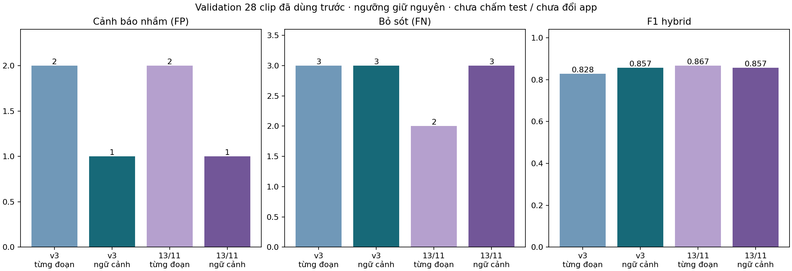

# Thử ngữ cảnh và phân tích lỗi Toxic — 15/11/2026

**Đã hoàn tất thử nghiệm, chưa thay model app.** Thêm đoạn ASR trước/sau giảm một cảnh báo nhầm trên validation nhưng làm checkpoint 13/11 bỏ sót thêm một clip. Không có cấu hình đạt điều kiện đã khóa trước chạy. Giữ app v3 và Violence v3; 200 nhãn Huy đã được nhập đầy đủ, không cần gán lại.

## Đã thực hiện

- Hoàn thiện báo cáo [train 5 epoch từ 200 nhãn](TOXIC_HUMAN_2026-11-13.md), sửa độ tương phản confusion matrix bằng dự đoán đã lưu; không chạy lại test.
- Thử thêm ngữ cảnh với **cả v3 và checkpoint epoch 2 ngày 13/11**, giữ nguyên trọng số, ngưỡng 0,78/0,80, ASR và bộ luật. Đây là thử nghiệm suy luận, không phải một lượt train mới.
- Chỉ đọc ASR của **142 train + 28 validation** theo nhóm nguồn đã khóa. Không chấm 30 test trong đợt 15/11. Validation đã dùng nhiều lần, không gọi kết quả này là đánh giá độc lập.
- Một cửa sổ gồm đoạn trước + đoạn giữa + đoạn sau nếu khoảng cách không quá 2 giây. Giữ token đoạn giữa trước, chia ngân sách còn lại cho hai bên, tối đa 192 token gồm token đặc biệt. Max điểm các cửa sổ tạo điểm clip; luật vẫn đọc đoạn ASR gốc.
- 926 cửa sổ; 913 có thêm ngữ cảnh, 1 đoạn giữa dài phải cắt như giới hạn hiện hành. 4 train thiếu ASR vẫn được tính vào số bỏ sót, không giả điểm 0 để tính loss.

Protocol được khóa trước suy luận: ứng viên phải có **ít FP hơn, FN không tăng và F1 không giảm so với cả hai checkpoint chấm từng đoạn** trên validation. Không quét ngưỡng sau khi thấy kết quả.

## Kết quả hybrid

| Split | Checkpoint / cách đọc | Accuracy | Precision | Recall | F1 | FP | FN |
|---|---|---:|---:|---:|---:|---:|---:|
| Train 142 | v3 / từng đoạn | 74,65% | 73,97% | 76,06% | 75,00% | 19 | 17 |
| Train 142 | v3 / thêm ngữ cảnh | 78,87% | 80,60% | 76,06% | 78,26% | 13 | 17 |
| Train 142 | 13/11 / từng đoạn | 74,65% | 73,33% | 77,46% | 75,34% | 20 | 16 |
| Train 142 | 13/11 / thêm ngữ cảnh | 78,17% | 79,41% | 76,06% | 77,70% | 14 | 17 |
| Validation 28 | v3 / từng đoạn | 82,14% | 85,71% | 80,00% | 82,76% | 2 | 3 |
| Validation 28 | v3 / thêm ngữ cảnh | 85,71% | 92,31% | 80,00% | 85,71% | 1 | 3 |
| Validation 28 | 13/11 / từng đoạn | 85,71% | 86,67% | 86,67% | 86,67% | 2 | 2 |
| Validation 28 | 13/11 / thêm ngữ cảnh | 85,71% | 92,31% | 80,00% | 85,71% | 1 | 3 |

So riêng với v3, ngữ cảnh có tín hiệu giảm báo nhầm. Tuy nhiên, nó chưa giữ được Recall của checkpoint 13/11. Vì không đạt điều kiện chung, `selection.json` có `selected: null`; không có ứng viên được kiểm CPU ngữ cảnh hoặc phát hành.

Model-only log-loss validation tăng nhẹ khi thêm ngữ cảnh: v3 **1,653390 → 1,732562**; checkpoint 13/11 **0,919738 → 0,935664**. Đây là loss trên 28 clip có ASR, không phải loss của quyết định hybrid. CSV ghi riêng mẫu số và chỉ số model-only. Ngữ cảnh không khôi phục được các từ mà ASR chưa nhận ra.

## Phân loại lỗi còn lại của checkpoint 13/11

Đối chiếu nhãn Huy, ASR đã lưu và quyết định hybrid trên dev; giữ nguyên nhãn. Đây là phân loại dấu hiệu quan sát được, chưa phải kết luận nguyên nhân qua một lượt nghe mới.

| Dấu hiệu | Train | Validation |
|---|---:|---:|
| Báo nhầm chỉ do classifier, luật không cảnh báo | 18 | 2 |
| Luật cảnh báo nhưng nhãn Huy là 0 | 2 | 0 |
| Bỏ sót, không có ASR | 4 | 0 |
| Bỏ sót, ASR có từ thuộc luật nhưng không qua điều kiện chất lượng audio | 2 | 0 |
| Bỏ sót, dưới ngưỡng classifier và không có từ thuộc luật | 10 | 2 |

Tổng cộng **40 ca lỗi dev** có bảng riêng để tiếp tục. Hai ca nhãn 0 nhưng ASR kích hoạt luật cần đối chiếu audio để phân biệt lỗi ASR với khác biệt cách hiểu nhãn; không tự đổi nhãn người dùng.

Có 18 mục bằng chứng của Huy chứa từ thuộc lexicon nhưng không thấy cùng từ trong ASR trùng mốc thời gian (15 train, 3 validation). Kiểm tra này chỉ tìm từ chính xác, không xử lý mọi biến thể, lỗi timestamp hoặc ý nghĩa câu. **Không phải WER/CER**, không thay thế transcript đã nghe xác minh.

Chi tiết có nhãn, mốc và ASR nằm private tại `runs/toxic-context-2026-11-15/development-audit-details.json` và `development-audit.csv`. Báo cáo công khai chỉ giữ số tổng hợp.

## Kiểm chứng và bước tiếp theo

- **284 tests pass**, 134,65 giây; thêm kiểm tra cửa sổ giữ đoạn giữa, giới hạn token, không rò nhóm nguồn/test và điều kiện không đánh đổi số bỏ sót lấy giảm FP. Đây là tests phần mềm, không phải 284 video phân loại đúng.
- Suy luận dev bằng CUDA FP32, không autocast/TF32. Phương pháp từng đoạn đối chiếu cache CPU trước đó: **0 thay đổi quyết định**, sai lệch điểm tối đa **1,574e-5**. Chưa có kiểm CPU cho cách thêm ngữ cảnh vì không có ứng viên đạt gate.
- Kiểm **17 artifact app v3** đúng checksum. Không thay API, trọng số/ngưỡng active, Violence hoặc tạo ZIP model mới. Không chạy HTTP/UI cho một ứng viên chưa phát hành.
- Đồ thị đã kiểm trực quan; nhãn trục được rút gọn khi render lại từ CSV để tránh chồng chữ. Không thay số liệu.

Ưu tiên lượt tiếp theo là kiểm ASR trên những ca phát triển đã có bằng chứng: lời nói bị mất, lặp trong một đoạn dài và từ bị chép sai. Sau đó kiểm cách học các câu bình thường để giảm báo nhầm classifier. Mọi thử nghiệm cần protocol mới, lựa chọn trên train/validation; giữ test cũ ngoài vòng điều chỉnh. Muốn kết luận cải thiện tổng quát cần video mới chưa dùng cho phát triển. Huy **không cần gán lại 200 clip**.

- [CSV Accuracy/Precision/Recall/F1/Loss](toxic-context-2026-11-15/metrics.csv)
- [CSV phân loại lỗi](toxic-context-2026-11-15/development-audit.csv)
- [Protocol](toxic-context-2026-11-15/protocol.json), [selection](toxic-context-2026-11-15/selection.json), [kết quả](toxic-context-2026-11-15/evaluation.json), [kiểm chứng](toxic-context-2026-11-15/verification.json)
- [Hướng dẫn tiếp tục](../docs/TOXIC_CONTEXT_2026-11-15.md)
