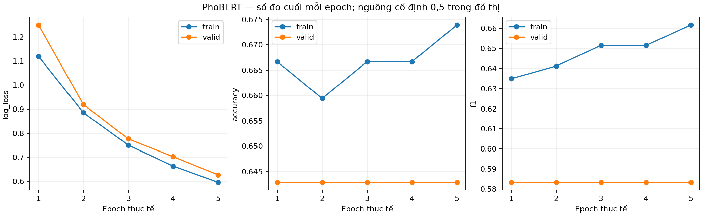
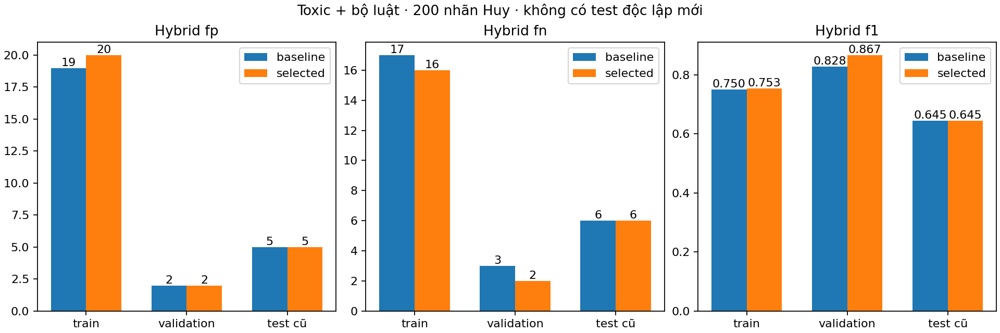
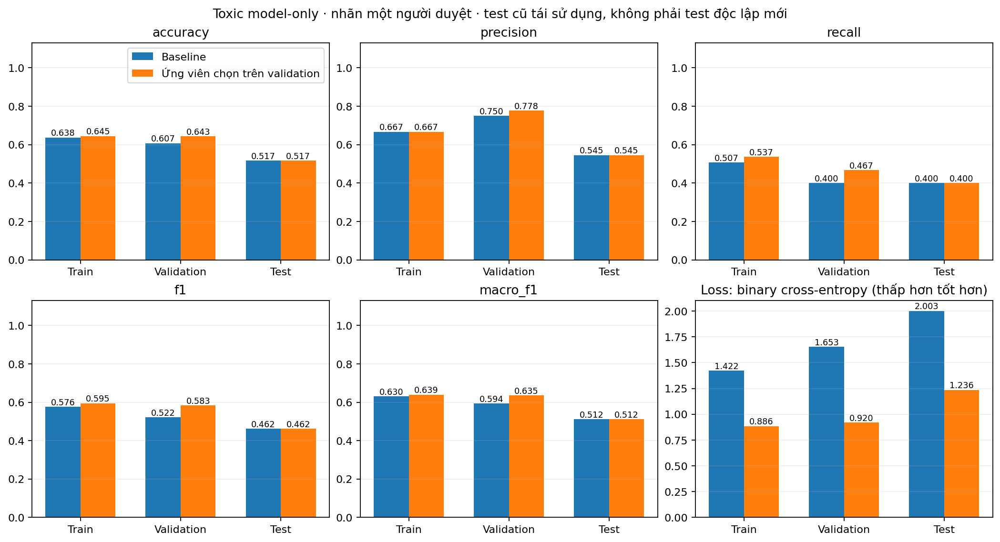

# Toxic sau khi Huy gán đủ 200 clip — 13/11/2026

**Đã nhập 200 nhãn, train đủ 5 epoch và chấm CPU trên train/validation/test cũ.** Ứng viên cải thiện một ca bỏ sót trên validation và giảm log-loss, nhưng chưa đổi quyết định nào trên 30 clip test cũ. Vì chưa chứng minh được cải thiện quyết định ngoài validation, giữ model app v3; checkpoint mới lưu riêng. Violence v3 không thay đổi.

## Nhãn và phạm vi

- File Huy gửi có 200/200 nhãn hợp lệ: **102 Toxic / 98 bình thường**, tất cả xác nhận đã nghe đủ và tiếng Việt. Có 8 nhãn khác nhãn nguồn trước đây, trong đó 5 thuộc train/validation. Bản tải được giữ nguyên, nhãn cũ còn trong manifest để đối chiếu.
- Nhãn do một người duyệt; không coi là đồng thuận mù độc lập giữa hai thành viên. Các ca lỗi cũ và ASR từng được xem trong quá trình phát triển. Chưa có transcript đầy đủ được người nghe xác minh, nên **không có WER/CER mới**; câu bằng chứng ngắn không thay thế toàn bộ transcript.
- Split giữ **142 train / 28 validation / 30 test** theo nhóm nguồn. Chỉ train/validation được dùng để chọn model/ngưỡng. Test cũ đã xuất hiện trong các đợt trước, lần này chấm lại sau selection với nhãn Huy; **không phải test độc lập mới** hoặc độ chính xác toàn app.
- ASR CPU small/beam5 cùng phục hồi lặp đã phát hành, giữ nguyên bộ luật. Có ASR cho 138/142 train, 28/28 validation, 29/30 test. 4 train và 1 test thiếu ASR vẫn được giữ trong bảng quyết định; không giả điểm 0 trong bảng xác suất.

## Huấn luyện và chọn model

PhoBERT v3 làm điểm khởi tạo; cập nhật hai encoder block cuối + classifier (14.767.874 tham số). Loss là BCE cấp clip qua max logit các đoạn ASR, cộng 0,5 lần CE trên batch 8 bình luận ViCTSD **train**, lấy mẫu cân bằng 4 âm + 4 dương. Không gán mọi câu trong clip Toxic thành Toxic. Learning rate encoder 5e-6/classifier 2e-5; tích lũy 8 clip, 5 epoch, seed42, CUDA FP16 cho train, FP32 cho dự đoán GPU so sánh.

Protocol khóa trước train. Chọn trên validation lời nói và bình luận: hybrid FP/FN không tăng, F1 model-only lời nói không giảm, Recall/F1 bình luận không giảm. Trong các điểm hợp lệ, ưu tiên F1 hybrid lời nói, ít FP, F1 bình luận, loss và epoch sớm. **Chọn epoch 2 / ngưỡng 0,80**. Quét ngưỡng v3 trên cùng điều kiện vẫn chọn 0,78, chưa tạo mức cải thiện tương tự chỉ bằng đổi ngưỡng.

Epoch 5 có một điểm giảm FP lời nói xuống 0 nhưng Recall bình luận còn 32,76%, không đạt điều kiện; không lấy checkpoint cuối chỉ vì loss thấp hơn. Mọi ngưỡng/epoch được chốt trước đánh giá test.

Đường học dùng ngưỡng **0,5 cố định**, vì vậy không trùng bảng tại ngưỡng chọn 0,80. Loss train/validation giảm trong 5 epoch không đồng nghĩa quyết định test đã tốt hơn. CSV có loss speech và replay trong tối ưu, cùng log-loss không trọng số đo sau mỗi epoch.

## Hybrid trên CPU — toàn bộ clip trong mỗi split

`FP` là báo nhầm, `FN` là bỏ sót. Clip không đủ ASR được tính là chưa cảnh báo (`review`) trong bảng này, không phải hệ thống khẳng định an toàn.

| Split | Phiên bản | Accuracy | Precision | Recall | F1 Toxic | FP | FN |
|---|---|---:|---:|---:|---:|---:|---:|
| Train 142 | v3 + luật | 74,65% | 73,97% | 76,06% | 75,00% | 19 | 17 |
| Train 142 | Ứng viên + luật | 74,65% | 73,33% | 77,46% | 75,34% | 20 | 16 |
| Validation 28 | v3 + luật | 82,14% | 85,71% | 80,00% | 82,76% | 2 | 3 |
| Validation 28 | Ứng viên + luật | 85,71% | 86,67% | 86,67% | 86,67% | 2 | 2 |
| Test cũ 30 | v3 + luật | 63,33% | 66,67% | 62,50% | 64,52% | 5 | 6 |
| Test cũ 30 | Ứng viên + luật | 63,33% | 66,67% | 62,50% | 64,52% | 5 | 6 |

Test có 16 nhãn Toxic / 14 bình thường. Không chỉ cùng số tổng: **0/30 quyết định model-only và hybrid thay đổi** giữa v3 và ứng viên. Train có 2 quyết định hybrid thay đổi; validation có 1. Mục tiêu giảm báo nhầm chưa đạt. Không so trực tiếp các số này với metric tháng 10 dùng nhãn yếu hoặc benchmark bình luận khác.

## Model-only và bộ luật

Trên clip có ASR, log-loss model-only giảm:

| Split có ASR | v3 | Ứng viên |
|---|---:|---:|
| Train 138 | 1,422462 | 0,885593 |
| Validation 28 | 1,653387 | 0,919737 |
| Test cũ 29 | 2,002644 | 1,235827 |

Model-only test trên **29 clip có ASR**: Accuracy 51,72%, Precision 54,55%, Recall 40,00%, F1 46,15%, FP5/FN9, không đổi. Nếu tính cả clip thiếu ASR thành chưa cảnh báo, model-only có FN10/F1 44,44%; hai mẫu số được ghi riêng trong CSV, không trộn lẫn. Hybrid không có xác suất/loss gộp.

Ablation bộ luật có trên đủ các split. Trên validation, chỉ luật FP0/FN4, ứng viên hybrid FP2/FN2: classifier bắt thêm 2 ca nhưng tạo thêm 2 báo nhầm. Trên train, chỉ luật FP2/FN20, ứng viên hybrid FP20/FN16. Những số phát triển này cho thấy classifier còn là nguồn cảnh báo nhầm đáng kể. Chỉ luật trên test cũ F1 76,92%/FP0/FN6 là số mô tả sau selection; không dùng kết quả test này để tự chuyển app sang rule-only.

## Bình luận ViCTSD validation đã biết

1.975 mẫu (1.743 bình thường / 232 Toxic), được dùng làm ràng buộc validation trong lượt mới, không phải đánh giá độc lập:

| Chỉ số | v3, ngưỡng 0,78 | Ứng viên, ngưỡng 0,80 |
|---|---:|---:|
| Accuracy | 90,18% | 90,18% |
| Precision Toxic | 58,41% | 58,12% |
| Recall Toxic | 56,90% | 58,62% |
| F1 Toxic | 57,64% | 58,37% |
| FP / FN | 94 / 100 | 98 / 96 |
| Log-loss | 0,444415 | 0,346057 |

Recall/F1 không bị giảm như ứng viên precision tháng 10, nhưng FP bình luận tăng 4. CSV cũng có ứng viên tại **cùng ngưỡng 0,78**: Recall 58,62%, F1 57,75%, FP103/FN96; cho thấy cần tách ảnh hưởng trọng số và ngưỡng. Chưa có thí nghiệm ablation riêng để khẳng định toàn bộ lợi ích do rehearsal.

## Kiểm chứng và trạng thái bàn giao

- **280 tests pass**, 125,17 giây; tests kiểm thuật toán nhập nhãn, không rò split, replay train cân bằng, ràng buộc Recall và các chức năng app hiện có. Đây không phải 280 video phân loại đúng.
- Kiểm CPU thật cả 200 clip × 2 model trên ASR đã lưu. So với GPU trên 166 clip train/validation có ASR: **0 thay đổi quyết định**, lệch điểm tối đa **1,699e-5**.
- 17 artifact app v3 giữ đúng checksum. Model mới 8 tệp được kiểm theo selection; giữ checkpoint, optimizer/RNG, cache và bản nhãn private. Không sửa model/ngưỡng Violence, API hoặc model active; không tạo ZIP phát hành mới.
- PNG đường học, so sánh hybrid và bảng chỉ số đã được xem kiểm nhãn/trục. Có confusion matrix và đường PR/ROC model-only của test cũ. Không có HTTP/UI nghiệm thu model mới vì ứng viên chưa được phát hành.

**Việc tiếp theo:** dùng các ca train/validation có nhãn đã duyệt để sửa cách classifier học và gộp các câu bình thường; đối chiếu bằng chứng có mốc với ASR cho ca bỏ sót. Không cần Huy gán lại 200 nhãn. Nếu cần đo ASR, chỉ bổ sung bản chép đầy đủ cho một nhóm phát triển đã chọn; không giả transcript từ trích đoạn. Cần nguồn video mới chưa dùng để đánh giá độc lập ở một đợt sau; không tiếp tục dò ngưỡng bằng 30 test cũ.

## Tệp để tiếp tục

- [Protocol](toxic-human-2026-11-13/protocol.json), [audit nhãn](toxic-human-2026-11-13/import-audit.json), [selection](toxic-human-2026-11-13/selection.json), [quyết định giữ v3](toxic-human-2026-11-13/release-decision.json).
- [History CSV](toxic-human-2026-11-13/training_history.csv), [model-only CSV](toxic-human-2026-11-13/metrics_by_split.csv), [hybrid/model/rule CSV](toxic-human-2026-11-13/decisions_by_split.csv), [bình luận CSV](toxic-human-2026-11-13/written-validation.csv).
- [Confusion matrix](toxic-human-2026-11-13/confusion_matrix.png), [PR/ROC test cũ](toxic-human-2026-11-13/test_curves.png), [CPU parity](toxic-human-2026-11-13/cpu-parity.json), [evaluation](toxic-human-2026-11-13/evaluation.json).
- Private: `runs/toxic-human-2026-11-13/CONTINUE.md`, `annotations-original.json`, `manifest.json`, `toxic/selected/`, `development-errors.csv`, `cpu-predictions.csv`. [Lệnh và quy trình](../docs/TOXIC_HUMAN_2026-11-13.md).
