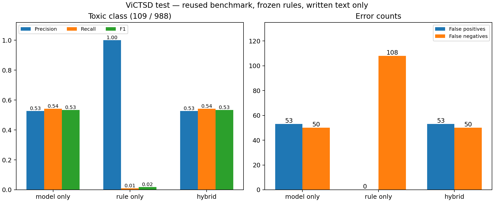

# Kết quả Toxic hybrid — 29/10/2026

Đã thêm bộ luật từ/cụm từ bên cạnh PhoBERT, dùng transcript Whisper tiếng Việt. Giữ trọng số CPU v3/ngưỡng 0,78, Violence và schema 1.0; đây là thay đổi inference, **không phải lượt train mới**. [Quy tắc và cách chạy](../docs/TOXIC_HYBRID.md).

## Ablation benchmark cũ

Khóa 18 luật (14 có thể cảnh báo, 4 chỉ gợi ý), hash và protocol trước tính metric. Tái sử dụng cache dự đoán PhoBERT ngày 28/10, kiểm danh tính/nhãn/nhóm/ngưỡng với ViCTSD đã xác minh checksum. Không điều chỉnh theo kết quả test; benchmark này từng được báo cáo, không gọi là tập test đích mới chưa từng xem. Đây là bình luận viết, không kiểm tra ASR hoặc heuristic chất lượng audio của app.

Test: **988 câu, 879 không Toxic / 109 Toxic**. Cảnh báo hybrid = model OR luật rõ ràng. Viết tắt review không được tính là dự đoán dương tính.

| Cách dự đoán | Accuracy | Precision Toxic | Recall Toxic | F1 Toxic | FP | FN | Log loss |
|---|---:|---:|---:|---:|---:|---:|---:|
| PhoBERT | 89,57% | 52,68% | 54,13% | 53,39% | 53 | 50 | 0,4641 |
| Chỉ bộ luật | 89,07% | 100% | 0,92% | 1,82% | 0 | 108 | Không áp dụng |
| Kết hợp | 89,57% | 52,68% | 54,13% | 53,39% | 53 | 50 | Không áp dụng |

Luật chỉ cảnh báo **1/988 câu**, câu này PhoBERT đã cảnh báo đúng. Precision 100% chỉ trên **một dự đoán dương**, không chứng minh độ tin cậy cao. Accuracy gần 89% của rule-only chủ yếu do tập lệch lớp. Validation 1.975 câu: rule-only không cảnh báo câu nào, precision không xác định; hybrid giữ F1 57,64% như PhoBERT. **Chưa có tăng chất lượng benchmark hoặc bằng chứng giảm báo nhầm nói chung.** Không thay PhoBERT bằng bộ từ khóa.

- [CSV validation/test](toxic-hybrid-2026-10-29/metrics.csv), [JSON](toxic-hybrid-2026-10-29/metrics.json), [protocol/hash](toxic-hybrid-2026-10-29/protocol.json), [SVG](toxic-hybrid-2026-10-29/ablation.svg).
- Rule/hybrid chỉ xuất quyết định, không có xác suất gộp; không tính loss hoặc dựng learning curve cho chúng. [Lịch sử train/loss thật của PhoBERT](MODEL_IMPROVEMENT_2026-10-28.md) vẫn là báo cáo huấn luyện hiện hành.

## Ba ca người dùng chỉ ra

Replay transcript/điểm thật đã lưu sau bản sửa ASR, sau đó kiểm lại qua HTTP/model thật. Đây là ca phát triển đã xem, không phải đánh giá test hoặc nhãn chuẩn từng segment.

| Video | PhoBERT max | Model-only | Có luật cảnh báo | Hybrid |
|---|---:|---|---|---|
| vi-speech-048 | 0,901374 | flagged | Có | flagged |
| vi-speech-019 | 0,002520 | review | Không | review |
| vi-speech-022 | 0,022752 | review | Có | flagged |

`022` có từ tục trong transcript nhưng model chấm thấp; bộ luật bổ sung cảnh báo và giữ nguyên điểm thật. `019` vẫn không được cảnh báo; cần nghe đối chiếu và xử lý ASR/bằng chứng trên dev, không đoán thêm từ vào transcript. Có **2/3 ca được cảnh báo**, không dùng con số này làm Accuracy/Recall của model.

CSV tổng hợp: [development_cases.csv](toxic-hybrid-2026-10-29/development_cases.csv). Raw video/transcript/JSON chẩn đoán chỉ ở `runs/toxic-hybrid-2026-10-29/`, không đưa vào Git.

## Giới hạn và bước tiếp

Kiểm chứng triển khai: **238 tests pass (66,54 giây)**, **7/7 HTTP/model thật** gồm ba ca trên, im lặng, âm đơn tần và hai pilot thuộc train. Im lặng/âm đơn tần giữ Toxic=null, không tạo evidence lời nói; hai pilot có điểm Toxic và giữ review. 17 artifact CPU v3 đúng checksum. Các ca này là kiểm kỹ thuật, không thay thế đánh giá nội dung có nhãn.

Trình duyệt thật: upload/kiểm clip022, cảnh báo do bộ luật, điểm model 0,023, playback từ giây10; TXT/JSON tải thật có nguồn cảnh báo và schema đúng. Raw output/screenshot chỉ lưu local. [HTTP checks](toxic-hybrid-2026-10-29/http_checks.json), [xác nhận test/UI](toxic-hybrid-2026-10-29/verification.json).

Bộ luật phụ thuộc ASR đúng, từ/cụm trong danh sách, ranh giới segment và ngữ cảnh. Điều kiện avg_logprob/compression_ratio là heuristic; không ngăn hết ảo giác ASR. Phần model vẫn có các FP cũ. Kết hợp bằng OR có thể tăng FP trên video đích, dù benchmark hiện tại không đổi; cần đo trên clip bình thường đã duyệt nhãn. Chưa có đánh giá độc lập speech200 hoặc lượt train mới từ 200 video.

Giữ 11 clip liên quan các ca đã xem khỏi test độc lập, hoàn tất nhãn thật và nhóm nguồn trước train/dev/test. Có thể phát triển thêm từ vựng từ **train/dev**, nhưng cần phiên bản mới và không lựa chọn dựa vào test này.
