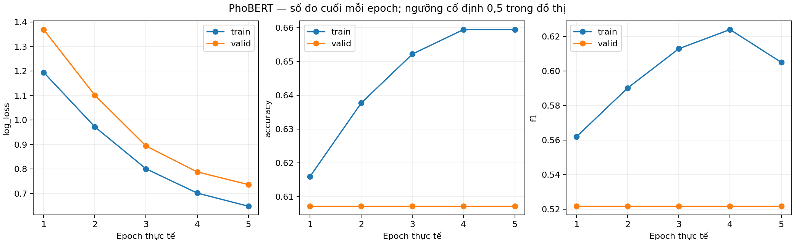
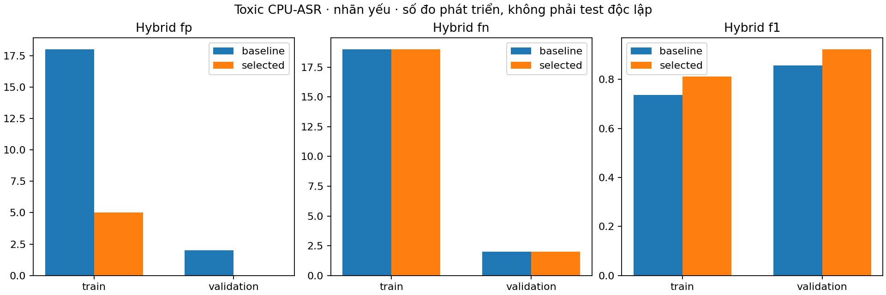

# Toxic theo ASR CPU, ưu tiên giảm báo nhầm — 29/10/2026

**Đã train đủ5epoch và kiểm CPU. Giữ nguyên Violence v3. Toxic mới lưu riêng, chưa kích hoạt:** hybrid cải thiện trên validation video nhỏ, nhưng classifier bỏ sót nhiều hơn trên validation bình luận. Chưa có kết quả test độc lập mới.

## Dữ liệu và cách train

- Giữ nguyên split speech200 theo nhóm nguồn:142train/28validation/30test. Đợt này chỉ chạy train/validation; không tái đánh giá hoặc dùng test cũ để chọn ngưỡng. Nhãn0/1 vẫn là **nhãn yếu do người cung cấp mô tả**, chưa phải toàn bộ nhãn nghe duyệt.
- Whisper small CPU INT8/beam5/VAD tạo170cache. Đủ ASR138train +28validation;4train thiếu ASR giữ riêng, không coi xác suất bằng0. Tổng785/162segment. So cache GPU FP16 cũ,122/142train và28/28validation khác transcript sau chuẩn hóa; khác chữ không tự chứng minh bản nào đúng.
- PhoBERT khởi tạo v3, cập nhật hai encoder block cuối + classifier:14.767.874 tham số. MIL lấy max logit cấp clip; không gán mọi câu của clip Toxic thành câu Toxic. Loss clip âm tính nhân2, tích lũy8clip, encoder LR5e-6/classifier2e-5, seed42,5epoch.
- Protocol khóa trước train. Chọn trên validation với ràng buộc hybrid FP không tăng, hybrid recall không giảm và model-only FP không tăng. Chọn **epoch5, ngưỡng0,84**. Bộ luật v1 giữ nguyên.

## Validation video:28clip,14mỗi lớp theo nhãn nguồn

Kiểm CPU bằng chính `PhoBertClassifier` dùng trong app, trên transcript CPU đã khóa:

| Chỉ số | v3 + luật | Ứng viên + luật |
|---|---:|---:|
| Accuracy |85,71%|92,86%|
| Precision Toxic |85,71%|100,00%|
| Recall Toxic |85,71%|85,71%|
| F1 Toxic |85,71%|92,31%|
| Báo nhầm FP |2|0|
| Bỏ sót FN |2|2|

Đây là **tập đã dùng chọn model/ngưỡng**, số mẫu rất nhỏ và chưa nghe xác minh hết. Precision100% trên14clip bình thường không có nghĩa app không báo nhầm trong thực tế.

Riêng model, không có luật: Accuracy64,29%→67,86%; F154,55%→52,63%; Recall42,86%→35,71%; FP2→0 nhưng FN8→9. Log-loss giảm1,673817→0,736883. Không có xác suất hoặc log-loss tổng hợp cho hybrid.

Kiểm mô tả sau khi khóa ứng viên: chỉ dùng luật đạt F188%,FP0/FN3. Hybrid ứng viên phát hiện thêm1clip so với luật. Dò cùng dải ngưỡng0,05–0,95 cho v3 trên validation vẫn còn2FP khi giữ recall; đây là chẩn đoán validation, không đổi selection đã khóa. Bộ dữ liệu vốn được sàng lọc ASR/keyword nên kết quả luật có thể được hưởng lợi từ thiên lệch thu thập.

## Train và đường học

Hybrid trên toàn142train: Accuracy73,94%→83,10%; F173,76%→81,25%; FP18→5; FN giữ19, gồm các clip thiếu ASR. Đây là số đo train, không dùng làm bằng chứng tổng quát hóa.

Log-loss không trọng số cuối epoch1→5: train1,194833→0,648664; validation1,369426→0,736883. Cột `optimizer_weighted_clip_loss` là mục tiêu tối ưu có trọng số riêng. Đồ thị history dùng ngưỡng cố định0,5, vì vậy Accuracy/F1 không trùng bảng tại ngưỡng chọn0,84.

## Kiểm regression bình luận ViCTSD

Dùng lại1975mẫu **validation đã biết**, không mở test; giữ nguyên hai ngưỡng đã khóa, không dò chỉnh theo kết quả này:

| Chỉ số model-only | v3 | Ứng viên |
|---|---:|---:|
| Accuracy |90,18%|90,94%|
| Precision Toxic |58,41%|71,90%|
| Recall Toxic |56,90%|37,50%|
| F1 Toxic |57,64%|49,29%|
| FP / FN |94 /100|34 /145|
| Log-loss |0,444415|0,269886|

Accuracy tăng do giảm báo nhầm ở lớp bình thường đông hơn, trong khi Recall/F1 Toxic giảm. Vì vậy không kết luận model mới tốt hơn toàn diện và **không thay model app**. Kết quả là đánh đổi tại các ngưỡng đã khóa, chưa tách riêng ảnh hưởng thay trọng số và thay ngưỡng trên bộ bình luận.

## Phiếu nghe duyệt và trạng thái

- Huy đã đồng ý nghe10clip. Phiếu private có4train+6validation,10nhóm nguồn,175giây; chọn5nghi FP+5nghi FN từ baseline với transcript GPU của đợt trước. Phiếu ẩn ASR/dự đoán, nhãn người vẫn trống lúc bàn giao. Các ca là bất đồng với nhãn nguồn, chưa phải lỗi đã được người xác nhận.
- [Mở phiếu local](http://127.0.0.1:8767/review-huy.html), [hướng dẫn và lệnh mở lại](../docs/TOXIC_PRECISION_2026-10-29.md). Nghe, ghi nhãn/bằng chứng, tải JSON rồi gửi đường dẫn. Không đưa nhãn validation vào fit.
- Kiểm CPU28validation: không đổi quyết định baseline/ứng viên so với GPU cùng transcript; sai khác điểm lớn nhất1,574e-5. Checkpoint8tệp được đối chiếu hash;17artifact app vẫn đúng manifest CPUv3. Không sửa API, launcher, model đang dùng hoặc trọng số/ngưỡng Violence.
-41tests mục tiêu pass cho chọn mẫu, split, loss, ràng buộc selection và phiếu nhãn. Phiếu HTTP200, video tải được trong trình duyệt, không lỗi giải mã trên clip kiểm giao diện.

Checkpoint local: `runs/toxic-precision-2026-10-29/toxic/selected/`; cache/phiếu/log/optimizer/RNG ở cùng run. Đọc `CONTINUE.md` trước khi tiếp tục, không chạy lại selection hoặc dùng test cũ dò ngưỡng. Cần nhãn và transcript người xác nhận để thiết kế bước tiếp, sau đó đánh giá trên nguồn video mới chưa xem trước khi khẳng định cải thiện ngoài validation.

## Tệp kết quả

- [Protocol](toxic-precision-2026-10-29/protocol.json), [selection/checksum](toxic-precision-2026-10-29/selection.json), [ASR audit](toxic-precision-2026-10-29/asr_audit.json).
- [History CSV](toxic-precision-2026-10-29/training_history.csv), [model CSV](toxic-precision-2026-10-29/model_metrics.csv), [hybrid CSV](toxic-precision-2026-10-29/hybrid_metrics.csv).
- [CPU validation](toxic-precision-2026-10-29/cpu-validation.json), [ngưỡng validation](toxic-precision-2026-10-29/validation_thresholds.csv), [ablation](toxic-precision-2026-10-29/validation-ablation.json).
- [Regression ViCTSD validation CSV](toxic-precision-2026-10-29/written-validation.csv), [protocol regression](toxic-precision-2026-10-29/regression-protocol.json).
