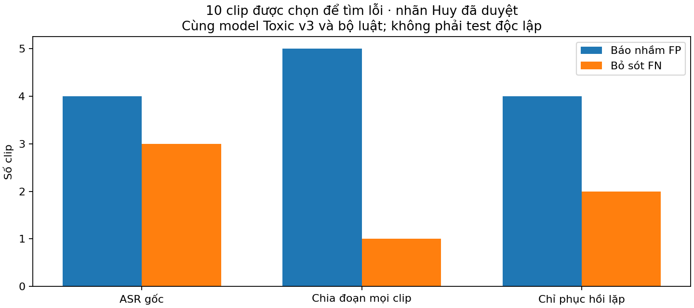

# Nhập nhãn người duyệt và phục hồi ASR lặp — 30/10/2026

**Đã nhập10nhãn Huy xác nhận và tích hợp phục hồi ASR lặp.** Trọng số/ngưỡng Toxic và Violence vẫn là v3. Chỉ nhận dạng lại những transcript thỏa điều kiện lặp bất thường; không bật chia đoạn cho mọi video vì cách đó làm tăng báo nhầm trên validation.

## Nhãn và phạm vi

File tải từ Chrome ban đầu có9nhãn:5dương/4âm, một nhãn trống. Sau hai xác nhận trực tiếp của Huy trong chat, bản giải quyết có **10/10 nhãn,5Toxic/5bình thường**. Một nhãn trống được xác nhận dương; một câu dùng để nhấn mạnh được xác nhận âm. File gốc giữ nguyên; bản giải quyết và nguồn xác nhận được lưu riêng. Bằng chứng của nhãn chuyển âm được giữ dưới dạng ngữ cảnh cũ, không còn tính là bằng chứng Toxic.

10clip gồm4train +6validation, từ10nhóm nguồn; chọn theo bất đồng của đợt trước nên **không đại diện cho độ chính xác toàn app**. Sau giải quyết,10nhãn trùng với nhãn nguồn ban đầu, nhưng nay chỉ10clip này có xác nhận từng clip từ người nghe.190clip còn lại vẫn chưa được nâng thành nhãn đã duyệt. Không đưa validation vào fit hoặc tái đánh giá test cũ.

Tất cả `corrected_transcript` vẫn trống và `transcript_verified=false`. Các câu ngắn/mốc người nghe ghi là bằng chứng, không phải bản chép toàn bộ audio; không tính WER/CER từ chúng.

## Đối chiếu model đã có

Trên đúng10clip đã duyệt, với ASR CPU cũ:

| Phiên bản Toxic | FP | FN |
|---|---:|---:|
| v3 + luật |4|3|
| Ứng viên precision + luật |2|3|

Ứng viên precision vẫn để riêng vì regression ViCTSD validation giảm Recall56,90%→37,50%. [Kết quả5epoch, Accuracy/Loss, CSV và đồ thị](TOXIC_PRECISION_2026-10-29.md). Việc nhập nhãn lần này không được ghi thành lượt train mới.

Ba ca bỏ sót có bằng chứng từ người nghe nhưng ASR làm mất hoặc chép sai từ quan trọng. Một ca bị lặp gần suốt clip thành câu bình thường; hai ca khác biến đổi từ hoặc mất dấu/âm. Các ca bình thường còn bị v3 gán điểm cao cho thấy lỗi classifier vẫn tồn tại, không thể quy mọi lỗi cho ASR.

## Thử ASR có kiểm soát

Khóa hai cấu hình trước chạy4clip train: (A) ép tiếng Việt sau gate ngôn ngữ + penalty lặp; (B) cửa sổ10giây/chồng1giây, beam5, temperature0, không VAD trong cửa sổ và không prompt từ khóa. Cả hai chạy CPU INT8 với cùng Whisper small và cùng v3 + luật.

- Train4: baseline FP2/FN1; A FP2/FN1 và1clip mất ASR; B FP2/FN0. Chọn B trên train, khóa trước khi chạy6validation.
- Validation6: baseline FP2/FN2; B FP3/FN1. Vì tăng báo nhầm nên **không áp dụng B đại trà**.
- Thời gian retry đo thực: A22,69giây/4clip, B34,74giây/4clip train và52,23giây/6clip validation. Baseline tái dùng cache nên thời gian để trống, không ghi0như độ trễ thật. Các số này chỉ gồm phần retry theo cách đo trong script, không phải latency toàn app.

## Sửa có điều kiện

Pipeline small/beam5/temperature0 chỉ thử nhận dạng lại khi:

1. ASR lượt đầu xác nhận tiếng Việt với xác suất ngôn ngữ≥0,5.
2. Có ít nhất4segment cùng câu sau chuẩn hóa, câu có≥3từ và chiếm≥50%segment không rỗng.
3. Retry theo cửa sổ10giây/chồng1giây. Chọn transcript theo việc hết lặp, **không chọn theo điểm Toxic hoặc có từ chửi**. Retry rỗng, lỗi hoặc vẫn lặp thì giữ transcript cũ và cảnh báo cần đối chiếu.

Quét170cache train/validation phát hiện3ca kích hoạt, đều thuộc train;167ca còn lại giữ nguyên. Trong3ca có1nhãn người vừa duyệt và2nhãn yếu nguồn. Cả3 chuyển từ chưa cảnh báo Toxic sang cảnh báo khi dùng v3 + luật.85clip nhãn nguồn bình thường không kích hoạt trên cache này; đây không phải bằng chứng mọi video bình thường bị lặp trong tương lai đều an toàn.

Trên10clip đã duyệt, cùng v3 và cùng bộ luật:

| ASR | FP | FN |
|---|---:|---:|
| Lượt đầu hiện hành |4|3|
| Chia đoạn mọi clip — không phát hành |5|1|
| Chỉ phục hồi khi lặp — đã tích hợp |4|2|

Đây là kết quả phát triển trên mẫu chọn theo lỗi, không công bố như Accuracy/F1 test mới. Phần FP4 chưa được giải quyết bằng sửa ASR này.

## Kiểm chứng và bàn giao

- **264tests pass**, bao gồm không ép tiếng Việt khi gate không đạt, không retry transcript bình thường, không chọn transcript theo từ chửi, giữ bản cũ khi retry lỗi/rỗng, mốc thời gian tuyệt đối và ghép pipeline/bộ luật.
- **7/7 kiểm API thật pass**, được ghi trong [HTTP check](toxic-reviewed-2026-10-29/http-check.json); pass nghĩa là hành vi đúng kỳ vọng regression, không phải tất cả video đều được phân loại đúng. Có cả ca bỏ sót đã biết được giữ để không che giấu hạn chế. [Bản ghi xác minh](toxic-reviewed-2026-10-29/verification.json) có hash code và manifest.
- Hậu tố kết quả mới: `+asr-repeat-recovery-v1`. Giữ schema1.0, điểm/evidence từ model thật và luật hiện hành; không nâng điểm khi luật khớp. Không sửa ZIP/trọng số/ngưỡng CPUv3 hoặc nhánh Violence. [Cách chạy và tái tạo](../docs/ASR_RECOVERY_2026-10-30.md).
- Mã, số tổng hợp và đồ thị được lưu Git; JSON nhãn, nguồn xác nhận, media, ASR, dự đoán từng clip và HTTP traces giữ private trong `runs/toxic-reviewed-2026-10-29/`. Run bắt đầu29/10, hoàn tất sau nửa đêm30/10 nên giữ nguyên run ID.

Bước tiếp theo: giảm FP của classifier trên lời nói bình thường bằng các clip train đã xác nhận và giữ kiểm regression ViCTSD để tránh mất Recall. Hai clip bình thường thuộc validation chỉ dùng đánh giá, không chuyển vào fit. Cần video mới chưa xem để đo kết quả test độc lập; không dùng10ca vừa phân tích như test mới.

## Artifact

- [Audit nhập nhãn](toxic-reviewed-2026-10-29/import-audit.json), [đối chiếu model CSV](toxic-reviewed-2026-10-29/reviewed-error-counts.csv).
- [Protocol ASR](toxic-reviewed-2026-10-29/protocol.json), [train CSV](toxic-reviewed-2026-10-29/asr-train-counts.csv), [validation CSV](toxic-reviewed-2026-10-29/asr-valid-counts.csv), [selection](toxic-reviewed-2026-10-29/asr-selection.json).
- [Protocol phục hồi lặp](toxic-reviewed-2026-10-29/recovery-protocol.json), [audit170cache](toxic-reviewed-2026-10-29/recovery-audit.json), [so sánh CSV](toxic-reviewed-2026-10-29/reviewed-asr-comparison.csv).
