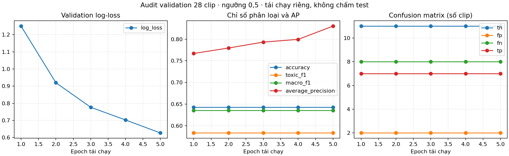

# Audit PhoBERT lời nói — kết quả tự sinh

Pipeline và dữ liệu gốc được giữ nguyên. Chỉ inference validation; test chỉ dùng kiểm count/hash/trùng ASR, không dùng tuning.

## Số lượng và nhãn

| Split | Video | Nguồn video | Nhóm train | Nhãn 0 / 1 | Có ASR | Segments |
|---|---:|---:|---:|---:|---:|---:|
| train | 142 | 92 | 86 | 71 / 71 | 138 | 764 |
| valid | 28 | 20 | 20 | 13 / 15 | 28 | 162 |
| test | 30 | 20 | 20 | 14 / 16 | 29 | 232 |

## Kiểm chứng split, nhãn và cache

- Tái tạo split từ code gốc: 0 sai khác; media SHA sai: 0; mapping nhãn sai: 0.
- `video_id`: 200 giá trị, 0 mục thiếu, 0 giá trị xuất hiện ở nhiều split.
- `original_video_id`: 200 giá trị, 0 mục thiếu, 0 giá trị xuất hiện ở nhiều split.
- `sha256`: 200 giá trị, 0 mục thiếu, 0 giá trị xuất hiện ở nhiều split.
- `source_group_id`: 132 giá trị, 0 mục thiếu, 0 giá trị xuất hiện ở nhiều split.
- `training_group`: 126 giá trị, 0 mục thiếu, 0 giá trị xuất hiện ở nhiều split.
- `speaker_id`: 0 giá trị, 200 mục thiếu, 0 giá trị xuất hiện ở nhiều split.
- `source_channel_id`: 100 giá trị, 0 mục thiếu, 12 giá trị xuất hiện ở nhiều split.
- `query_speaker_group`: 29 giá trị, 0 mục thiếu, 18 giá trị xuất hiện ở nhiều split.
- `speaker_id` chưa được xác minh. Kênh và từ khóa tên người nói là proxy; không chứng minh speaker-disjoint.
- Cache dev: 340 bản ghi kiểm theo ID/nhãn/split/ngưỡng/hash, 0 bản ghi lệch; thứ tự NPZ khớp.
- Nhãn dùng thực tế: `training_label == annotation.toxic_language`. `human_label`/`label_origin` cũ còn giữ để truy vết; không dùng làm target.

## Trùng transcript và preprocessing

- ASR toàn clip: {'nonempty_records': 195, 'unique_texts': 194, 'duplicate_groups': 1, 'duplicate_excess': 1, 'cross_split_groups': 0, 'clip_label_disagreement_groups': 0, 'cross_split_label_disagreement_groups': 0}
- ASR từng đoạn: {'nonempty_records': 1158, 'unique_texts': 1111, 'duplicate_groups': 29, 'duplicate_excess': 47, 'cross_split_groups': 2, 'clip_label_disagreement_groups': 3, 'cross_split_label_disagreement_groups': 1}
- Bất đồng nhãn clip trên cùng ASR không tự chứng minh gán nhãn sai; đoạn bình thường có thể nằm trong clip Toxic. ASR boilerplate cũng có thể trùng.
- Preprocessing train/validation: {'segments': 926, 'max_length': 192, 'truncated': 1, 'max_full_tokens': 224, 'lost_after_normalization': 0, 'lost_after_word_segmentation': 0, 'lost_after_tokenization_truncation': 1, 'invalid_segment_timing': 43}
- NFC + casefold + gộp khoảng trắng → PyVi 0.1.1 → tokenizer PhoBERT; giới hạn 192 token gồm special tokens. Không dịch sang tiếng Anh.
- Không có transcript đầy đủ được người nghe xác minh; chưa tính WER/CER. Không gán nhãn video thành nhãn gold từng đoạn.

## Logits và metrics validation

P/R/F1 dưới đây là lớp Toxic=1. Macro-F1 lấy trung bình 2 lớp, weighted-F1 theo support. AP tính từ điểm liên tục. Ngưỡng cố định 0,5; gộp max ở cấp video.

| Snapshot | Loss | Accuracy | Toxic P | Toxic R | Toxic F1 | Macro-F1 | Weighted-F1 | AP | TN/FP/FN/TP |
|---|---:|---:|---:|---:|---:|---:|---:|---:|---|
| original_epoch0 | 1.653390 | 0.642857 | 0.777778 | 0.466667 | 0.583333 | 0.635417 | 0.631696 | 0.762907 | 11/2/8/7 |
| original_epoch2 | 0.919738 | 0.642857 | 0.777778 | 0.466667 | 0.583333 | 0.635417 | 0.631696 | 0.779535 | 11/2/8/7 |
| original_epoch5 | 0.626997 | 0.642857 | 0.777778 | 0.466667 | 0.583333 | 0.635417 | 0.631696 | 0.830048 | 11/2/8/7 |
| replay_epoch0 | 1.653390 | 0.642857 | 0.777778 | 0.466667 | 0.583333 | 0.635417 | 0.631696 | 0.762907 | 11/2/8/7 |
| replay_epoch1 | 1.249690 | 0.642857 | 0.777778 | 0.466667 | 0.583333 | 0.635417 | 0.631696 | 0.766897 | 11/2/8/7 |
| replay_epoch2 | 0.919738 | 0.642857 | 0.777778 | 0.466667 | 0.583333 | 0.635417 | 0.631696 | 0.779535 | 11/2/8/7 |
| replay_epoch3 | 0.776745 | 0.642857 | 0.777778 | 0.466667 | 0.583333 | 0.635417 | 0.631696 | 0.793207 | 11/2/8/7 |
| replay_epoch4 | 0.702734 | 0.642857 | 0.777778 | 0.466667 | 0.583333 | 0.635417 | 0.631696 | 0.799485 | 11/2/8/7 |
| replay_epoch5 | 0.626997 | 0.642857 | 0.777778 | 0.466667 | 0.583333 | 0.635417 | 0.631696 | 0.830048 | 11/2/8/7 |
| replay_selected | 0.919738 | 0.642857 | 0.777778 | 0.466667 | 0.583333 | 0.635417 | 0.631696 | 0.779535 | 11/2/8/7 |

## Probability drift

| Từ → đến | Mean absolute drift | Max drift | Flips | Flip rate |
|---|---:|---:|---:|---:|
| original_epoch0 → original_epoch2 | 0.09442083 | 0.27394149 | 0 | 0.0000% |
| original_epoch2 → original_epoch5 | 0.09678577 | 0.26457416 | 0 | 0.0000% |
| replay_epoch0 → replay_epoch1 | 0.03151496 | 0.10657710 | 0 | 0.0000% |
| replay_epoch1 → replay_epoch2 | 0.06290587 | 0.17861445 | 0 | 0.0000% |
| replay_epoch2 → replay_epoch3 | 0.03966859 | 0.09855600 | 0 | 0.0000% |
| replay_epoch3 → replay_epoch4 | 0.02356405 | 0.05992809 | 0 | 0.0000% |
| replay_epoch4 → replay_epoch5 | 0.03442032 | 0.10609007 | 0 | 0.0000% |

## Những gì xác minh được và giới hạn

- Run cũ có checkpoint epoch 2 và resume epoch 5; epoch 1/3/4 không còn checkpoint riêng. `replay_*` là lần tái chạy riêng bằng chính hàm train, không giả là log lịch sử.
- Kiểm checkpoint/shape `[segments, 2]`, `model.eval()` và `torch.inference_mode()` thực tế nằm trong `checkpoint-audit.json` và metadata private. So trọng số/điểm lần tái chạy với checkpoint gốc tại `replay-comparison.json`.
- Loss speech = BCEWithLogits trên max(z1-z0) theo video, thêm 0,5 CE từ ViCTSD train. Gradient speech chỉ đi qua đoạn thắng max; tác hại đến chất lượng là giả thuyết cần thí nghiệm.
- Chỉ số history được tính trên toàn validation sau epoch, không lấy trung bình F1 từng batch; `f1` trong history là binary Toxic, không phải macro.
- `.5` của history khác ngưỡng model active `.78` và checkpoint chọn `.80`; chỉ số hybrid gồm bộ luật khác model-only.
- Chưa có bằng chứng cache đóng băng gây plateau. Kiểm cache hiện tại không chứng minh mọi lần chạy cũ đều không lỗi.

## R0–R7 — kế hoạch, chưa tự triển khai các thay đổi model

| Mã | Bằng chứng/giả thuyết | Thí nghiệm tối thiểu | Cách đánh giá / điều kiện |
|---|---|---|---|
| R0 | History thiếu logits mỗi epoch | Audit/tái chạy với checkpoint + logits/ID đầy đủ; đã thực hiện | Tái hiện metrics, drift và checkpoint; không thay production |
| R1 | Source-disjoint nhưng speaker/channel proxy giao nhau | Xác minh speaker; tạo manifest chẩn đoán phụ từ TRAIN theo speaker/nguồn, giữ nguyên manifest gốc | Group-CV chỉ TRAIN; báo số nhóm/nhãn, không dùng test để chia lại hoặc chọn |
| R2 | Bỏ sót có ASR thiếu/sai; chưa có transcript chuẩn | Đối chiếu một nhóm TRAIN bằng transcript người xác minh; so ASR hiện hành với một thay đổi cố định | WER/CER chỉ khi có reference; coverage, FP/FN; không thêm prompt ép từ Toxic |
| R3 | Supervision là cấp clip, không phải từng đoạn | Xác minh đoạn evidence trên TRAIN rồi thử loss phụ cho các đoạn đã xác minh | Không gán mọi đoạn của clip Toxic thành 1; giữ cùng split, so với R0 |
| R4 | Max pooling chỉ truyền gradient qua một đoạn mỗi clip | Thử mean BCE trên đoạn của clip âm đã kiểm ASR, giữ max-MIL cho clip dương | Một thay đổi loss; cùng seed/LR/epoch/replay; báo FP, FN, AP và recall ViCTSD |
| R5 | Ngữ cảnh thử 15/11 giảm FP nhưng tăng FN so checkpoint 13/11 | Nếu R2/R3 đủ dữ liệu, train và infer cùng cửa sổ ngữ cảnh cố định | Không tự phát hành từ inference-only; giữ Recall, báo truncation |
| R6 | Loss/AP đổi nhưng quyết định tại 0,5 có thể chưa qua ngưỡng | Sau khi khóa trọng số, báo điểm vận hành và calibration trên dev; giữ .5 làm mốc | Chọn ngưỡng chỉ train/validation theo FP/Recall đã định; không tuning test |
| R7 | Validation dùng nhiều lần, thiếu test speaker độc lập mới | Khóa toàn bộ pipeline rồi đánh giá một lần trên tập mới có nguồn/quyền dùng và nhãn xác minh | Báo support/coverage/CI, FP/FN, CPU latency; không chọn lại model bằng test |

## Artifact

- Public: `counts.csv`, `overlaps.csv`, `validation-metrics.csv`, `probability-drift.csv`, `history-comparison.csv`, JSON và đồ thị.
- Private: `validation/<snapshot>/segments.csv`, `clips.csv`, `validation.npz`, `metadata.json`; checkpoint từng epoch, transcript/trùng/tiền xử lý ở cùng thư mục run.
- Không có logits test hoặc model mới được cài vào app.
