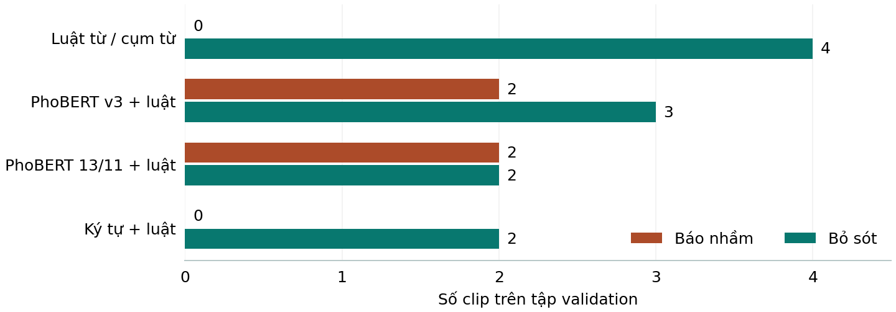

# Thử nghiệm phát hiện Toxic trên toàn bộ transcript

[Báo cáo PDF có bảng và biểu đồ](../../output/pdf/KidSafeReels_Toxic_2026-11-20.pdf)

Toàn bộ lời nhận dạng của mỗi clip được dùng làm một mẫu. Vectorizer học 4.534 đặc trưng ký tự từ 138 transcript có lời trong 142 clip train. Luật tiếp tục đọc các đoạn ASR gốc. Trong 5 lượt kiểm chéo có phân nhóm theo nguồn, cả vectorizer và logistic regression đều được fit lại bằng phần train của lượt đó. Tất cả quyết định dưới đây dùng cùng 28 clip validation.

| Cấu hình | Precision Toxic | Recall Toxic | F1 Toxic | Báo nhầm | Bỏ sót |
|---|---:|---:|---:|---:|---:|
| Luật | 100% | 73,33% | 84,62% | 0 | 4 |
| PhoBERT v3 + luật | 85,71% | 80,00% | 82,76% | 2 | 3 |
| PhoBERT 13/11 + luật | 86,67% | 86,67% | 86,67% | 2 | 2 |
| Ký tự + luật | 100% | 86,67% | 92,86% | 0 | 2 |



Hai bản hybrid 13/11 và 20/11 có cùng số bỏ sót nhưng khác nhau ở hai clip Toxic. ViCTSD validation cho F1 model đơn 18,05% với ứng viên ký tự và 58,37% với PhoBERT 13/11. Hai nhóm video được thu thập theo cách khác nhau và còn thiếu ID người nói đã xác minh. Ưu tiên lần thử tiếp theo là clip mới từ cùng thể loại/kênh có cả ví dụ Toxic lẫn bình thường, có nhãn người nghe trước khi chấm.

Các chỉ số từng cấu hình có ở [bảng quyết định](decision_metrics.csv) và [bảng loss, AP](model_metrics.csv). [Kết quả theo kênh](channel_slices.csv) và [đối chiếu từng quyết định theo số tổng](transfer-and-pairs.json) ghi các giới hạn. Thử nghiệm khóa [cấu hình](protocol.json) trước khi fit. Tập test cũ chỉ có số liệu lịch sử của PhoBERT trong báo cáo.

### Tái hiện trên máy có dữ liệu riêng của dự án

Chạy từ thư mục repo. Dùng mã lượt mới để giữ số liệu đã công bố.

```powershell
.\.venv\Scripts\python.exe -X utf8 -m ml.toxic_transcript_trial --run-id toxic-transcript-reproduce-01
.\.venv\Scripts\python.exe -X utf8 -m ml.toxic_transcript_checks --run-id toxic-transcript-reproduce-01
```

Checkpoint và dự đoán theo clip nằm trong `runs/toxic-transcript-2026-11-20/` trên máy Huy. Script vẽ hình và dựng PDF cho kết quả đã công bố lần lượt là `scripts/toxic_transcript_figures.py` (Matplotlib) và `scripts/report_toxic_transcript.py` (ReportLab, Arial trên Windows).
